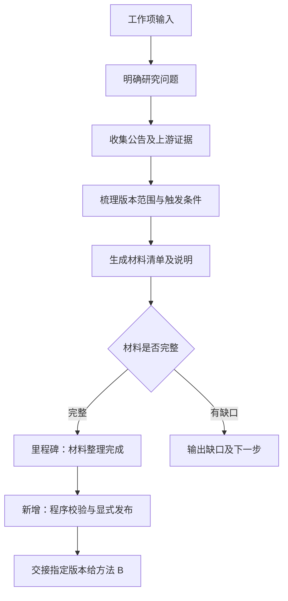
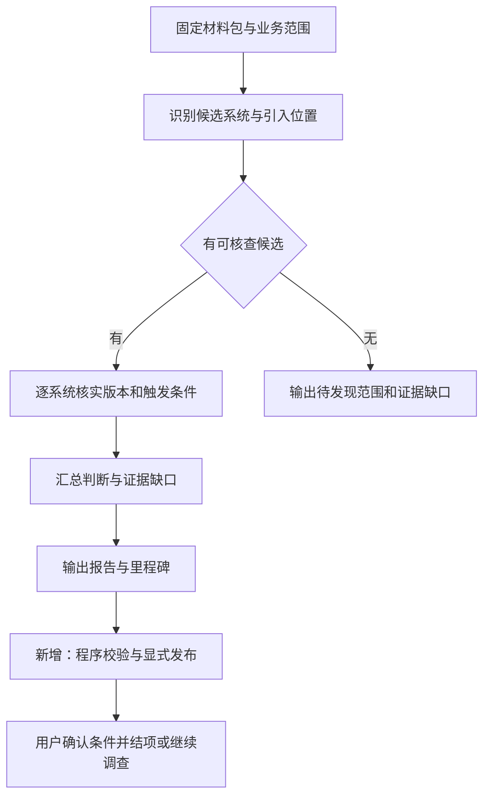

# 将 CVE 材料收集与业务影响分析创建为 Flowcraft 流水线

日期：2026-10-21。状态：基于源码的可行性分析与创建建议，尚未创建流水线、修改运行数据或验证真实模型路线。

2026-10-22 落地补充：[两条流水线 v1](../pipelines/cve/README.md) 已创建并采用。首版复用现有节点，通过 Pi MCP 插件调用 WebSearch，来源正文内联到节点结果，人工交接固定结果；下文的完整证据包、发布和自动接续仍为后续建议，不是首版的前置建设项。尚未进行真实模型调查。

分析基线：Flowcraft `6fa6e9d`；参考项目 `/home/mike/projs/main/cve-fix`，提交 `140728c`。本文中的新增接口、文件格式和工具名均为建议，不表示当前已经实现。

## 1. 结论与推荐路径

可以由 coding agent 帮用户创建两条流水线。当前 Flowcraft 已提供创建 Work、保存 Definition、保存布局、采用版本、创建 WorkItem 和发起运行的 HTTP 接口，足以把方法真实保存并展示在画布中。创建本身不要求先增加另一套 Agent 框架。

但应区分三个交付层次：

| 层次                   | 能交付什么                                                                           | 当前判断                             |
| ---------------------- | ------------------------------------------------------------------------------------ | ------------------------------------ |
| 创建方法               | 两条有节点、合同、连接、输入输出约束的流水线，可以打开和编辑                         | 已有接口可完成                       |
| 基于已有证据运行       | 用户明确提供漏洞材料和业务证据，流水线整理、分析、输出，人工确认并交接               | 可使用现有能力起步，仍需真实模型验证 |
| 复现原项目无人值守链路 | 自动搜索、源码和环境取证、保存完整证据包、程序验收、发布、触发另一流水线及更新后重算 | 有明确能力缺口，不能仅靠提示词兑现   |

推荐首先创建两条原生 Definition，用已有证据验证业务方法；随后补足取证、证据保存和确定性交接能力。原项目的提示词、产物合同、校验规则可以复用，manager、SQLite 队列和 tmux worker 无需整体搬进 Flowcraft。

## 2. 业务对象如何映射

| 原项目对象                                  | Flowcraft 中的对应方式                         | 说明                                                                                          |
| ------------------------------------------- | ---------------------------------------------- | --------------------------------------------------------------------------------------------- |
| `cve_materials`                             | 流水线“漏洞材料收集” / Work A                  | 一个方法供多个漏洞工作项使用                                                                  |
| `cve_business_impact`                       | 流水线“业务影响分析” / Work B                  | 方法定义与业务范围、环境事实分开                                                              |
| 漏洞条目及其调查目标                        | WorkItem                                       | 建议编号为“漏洞 ID + 业务范围”，例如 `CVE-2025-27516:产品A`；同一漏洞的不同调查范围可分别登记 |
| 一次 worker 尝试                            | Run                                            | 固定方法版本、工作项修订及输入；补证或换方法创建新 Run                                        |
| `manifest.json`、`notes.md`、原文及取证文件 | 结构化节点结果 + 版本化证据包                  | 节点结果可以现有方式保存，完整证据包的版本管理需要补充                                        |
| promote                                     | 显式发布一个经过校验的证据包或结论             | 不等于采用 Definition，也不等于 keepResults                                                   |
| bridge                                      | 发布材料后，向 Work B 交接明确版本并发起新 Run | 当前需要人工操作或新增小范围交接逻辑                                                          |
| 工作结束                                    | 用户确认完成条件并结项                         | Run 成功、模型判断完成、发布产物均不自动结项                                                  |

默认建议同一 WorkItem 先用 A，再切换到 B，保留同一业务身份和跨方法历史。当前一个工作项只有一个当前处理方法，存在等待或其他未决运行时不能换方法；A 必须先进入可交接的终态。

如果后续确有“某漏洞的官方材料供多个产品复用”的需求，可以另设材料调查工作项，多个业务调查项引用同一已发布证据包。首版不预建多对多任务平台。

工作项完成条件建议至少包含“关键漏洞事实有可复核来源”“约定业务范围均有判断或明确获接受的未决说明”“结论、证据和下一步已复核”。是否接受未决范围由用户确认，不能由模型自动勾选。

## 3. 两条方法的设计

以下是建议的目标流程。标为“新增”的步骤应由明确的应用动作或服务端程序承担；当前不能把它们配置成一个普通 Function 节点就视为实现。

### 3.1 流水线 A：漏洞材料收集

**最小输入**：漏洞条目 ID、组件名称或线索、已有公告/材料、需要确认的问题。漏洞 ID 不应使用只接受 `CVE-*` 的规则，原项目也处理 `WS-*` 等条目。

**输出**：官方事实、受影响范围、修复线索、利用前提、证据缺口，以及可复核的材料包引用。



| 步骤             | 当前可用节点 / 建议动作                          | 输入与输出合同                                                                                           |
| ---------------- | ------------------------------------------------ | -------------------------------------------------------------------------------------------------------- |
| 明确研究问题     | Agent，aggregate                                 | 读取本工作项全部材料及 `workItem.data`；输出漏洞 ID、组件、调查范围、待确认问题，不用模型知识填补事实    |
| 收集官方证据     | Agent，map，首版 concurrency=1                   | 目标为公告、受影响范围、补丁和源码；有搜索工具时开展真实取证，已有材料模式只读取明确提供的证据并披露范围 |
| 梳理漏洞成立条件 | Agent，map                                       | 输出攻击者可控输入、触发入口、必要配置、危险行为及修复切断点；无法确认的字段列为未知                     |
| 形成材料包候选   | Agent，aggregate                                 | 形成 manifest、可读说明及证据索引；保留原项目 completed/incomplete/failed 三种材料状态                   |
| 分流与进展       | Branch + Milestone                               | 依据材料状态分流。里程碑只表示整理取得进展；缺口分支输出阻碍，不伪称已经发布                             |
| 程序校验与发布   | 新增显式应用动作；首版可由操作者调用现有校验程序 | 校验指定 Run 的候选包；满足规则才生成可交接的发布版本，失败给出具体文件/字段问题                         |

节点不必把每个网页拆成一个画布步骤。首版可以由一个取证 Agent 完成多次查询，画布保留能检查输入输出、独立重试和解释责任的业务步骤。

材料包建议兼容原项目的主要字段，并补充版本与追溯信息：

```json
{
  "cve_id": "CVE-2025-27516",
  "status": "incomplete",
  "summary": "已核对公告，尚缺修复提交对应的源码证据。",
  "official_sources": [],
  "affected_range_evidence": [],
  "fix_evidence": [],
  "missing_evidence_reasons": ["修复提交尚未核实"],
  "raw_cache_paths": [],
  "trigger_conditions": [],
  "package_ref": null
}
```

这是字段示意，不是真实调查结果。`package_ref` 由保存/发布程序绑定，不让模型随意构造一个路径冒充已经存在的包。

**错误语义**：模型/网络失败、非法 JSON、Schema 不符属于执行失败，阻断依赖；材料不足可以是成功返回的 `status=incomplete`，但不得进入发布成功分支。来源冲突或找不到补丁应保留有效证据和缺口，补证另开新 Run。

### 3.2 流水线 B：业务影响分析

**最小输入**：明确版本的材料包、调查业务范围、依赖与部署线索、已知源码/配置/环境证据。原项目的 `vulnerabilities.clean.jsonl` 可作为来源，需明确选择相关记录，不能默认将全文件注入每个节点。

**输出**：逐系统判断、整体结论、证据、未决问题和建议动作。



| 步骤               | 当前可用节点 / 建议动作                 | 输入与输出合同                                                                                                |
| ------------------ | --------------------------------------- | ------------------------------------------------------------------------------------------------------------- |
| 读取材料与业务范围 | Agent，aggregate                        | 核对漏洞 ID、包版本、调查目标，整理候选系统；版本缺失或漏洞不匹配应拒绝后续判断                               |
| 检查并展开系统列表 | Function + Branch；flatMap + expression | 从结构化结果中提取候选数组，检查长度；非空才展开，每项携带相同材料版本和该系统线索；空数组保留缺口结果        |
| 逐系统核查         | Agent，map，首版 concurrency=1          | 核查组件/版本、真实调用路径、输入可控性、配置和部署前提；软件依赖侧优先源码检索，系统组件侧按实际环境线索调查 |
| 汇总与一致性整理   | Agent，aggregate；纯表达式辅助整理      | 输出受影响/已排除/待确认系统，以及整体结论；空候选不能直接解释为无影响                                        |
| 进展与报告         | Milestone；Agent 可报告进展             | 记录调查阶段、阻碍和下一步，引用实际结果，不确认完成条件                                                      |
| 校验与发布         | 新增显式应用动作                        | 检查整体与分项一致、证据存在、材料版本和业务范围一致后发布                                                    |

首版让逐系统 Agent 在自己的职责内选择是否需要源码或环境核查，避免两路空分支汇合、来源重叠和重复取证增加复杂度。发现实际并行需求后，再使用 Branch + collect/join 拆分两路。

空候选分支必须在 flatMap 之前保留一个明确的 `status=incomplete`、`overall_conclusion=undetermined` 结果。不能将空数组展开成零项后，因整条空支路结束就把它解释为成功排除所有系统。

整体结论沿用原项目的四种枚举：`impacted`、`partially_impacted`、`not_impacted`、`undetermined`。`status=completed` 表示本轮分析完成，与“业务没有影响”和“工作项已结项”分别判断。

**最小反例**：两个系统中，系统甲确认触发，系统乙尚缺部署证据。应输出 `partially_impacted`，甲进入受影响列表，乙进入待确认列表，不能因甲已确认就丢弃乙，也不能因乙未知把整体写成 `not_impacted`。

## 4. 实际如何创建

### 4.1 由当前 coding agent 完成的工作

本次只分析；后续创建可以直接调用现有 HTTP 接口，不依赖浏览器手工逐个画节点：

1. 生成 A/B 的 Definition：`schemaVersion:1`、问题认知、节点职责合同、输入输出 Schema、边和输出端口。
2. 调用 `POST /api/works` 分别创建两个方法工作区，通过 `rename` 设置清楚的标题。
3. 调用 `POST /api/works/:id/actions` 的 `saveDraft` 保存，带正确的 `expectedDraftId`；读取快照确认版本和 `issues`。
4. 通过 `saveLayout` 保存易读布局；实际打开画布检查节点和连接。结构有效后采用指定版本，采用与执行分开。
5. 登记一个真实调查范围的 WorkItem，绑定 A，填写明确完成条件及该项自己的材料。
6. 发起 A，核对真实结果；人工选定材料包，添加为工作项证据，再切换到 B、发起新 Run。
7. 验证结果来源、失败展示、跨方法历史和停止恢复后，再增加自动取证与交接。

如选择“已有证据模式”，标题/说明和任务必须明确只覆盖所给证据，不能把它称为已经完成自动材料搜集。

### 4.2 工作项输入的现有限制

当前 `/api/items/:id/actions` 的 `run` 要求 Definition 恰好一个输入端口，输入值是工作项每条材料的**文本**。`workItem.data` 同时进入 Agent 上下文，但不是 Function 可直接读取的图输入。

因此首版建议 A/B 都采用一个 `input` 入口，由第一个 aggregate Agent 结合材料和 `workItem.data` 形成结构化上下文。业务元数据可在创建工作项时保存为：

```json
{
  "cveId": "CVE-2025-27516",
  "library": "Jinja2",
  "businessScope": ["产品A"],
  "environment": "待核实的目标环境"
}
```

这避免复制原项目的 `inputs/materials/context/analysis` 多端口设计后，发现正式工作项无法启动。纯 Function 不能直接 `JSON.parse` 任意材料文本；若需要无需模型的严格结构化入口，需补充工作项启动输入映射，并复用 invoke 的入口契约校验。

普通 `/api/works/:id/invoke` 已支持结构化输入和入口契约，适合验证单次方法；它不会自动绑定 WorkItem，不能用 invoke 成功替代工作项进展与交接验证。

### 4.3 人工交接也需要明确内容

现有人工路径可完成“选结果摘要 → addEvidence → method → run”。但 addEvidence 目前追加文本，不自动建立跨 Work 的结构化结果来源。首版需在材料中明确保存源 `workId/runId/definitionId/resultId`、材料版本及所选正文，不能声称来源已被程序完整校验。

不能将 Work A 的结果 ID 直接当作 Work B 自己的结果使用。正式交接应增加一个受检查的材料包引用，并保留同一 WorkItem 的跨方法运行历史。

## 5. 能力对照与缺口

“已有”表示源码存在相应路径，不表示本次已经完成真实 CVE 场景验收。

| 能力                              | 当前事实                                                                                                                          | 本次创建的处理方式 / 最小补充                                                 | 优先级                 |
| --------------------------------- | --------------------------------------------------------------------------------------------------------------------------------- | ----------------------------------------------------------------------------- | ---------------------- |
| 方法创建、版本、布局、采用        | 已有 HTTP 与统一 Definition                                                                                                       | 直接复用；新增方法数据即可                                                    | 已有                   |
| Pi 工具循环、流式活动、取消       | 已接入                                                                                                                            | 继续复用 Pi，不移植另一套 manager loop                                        | 已有                   |
| map/flatMap/aggregate、分支、汇合 | 已有                                                                                                                              | 足以表达两条固定方法；首版无需 Dynamic                                        | 已有                   |
| 等待、到期、进展、跨方法历史      | 已有                                                                                                                              | 复用；运行中换方法仍受限制，Run 成功不结项                                    | 已有                   |
| 官方搜索、页面读取、Sourcegraph   | 普通执行节点现通过 Pi MCP 插件获得 WebSearch 的 search/fetchWebContent/fetchGithubReadme；另有 inspect_material、本地工具和正式执行的 report_progress；Sourcegraph 尚未接入 | 复用已接入的 WebSearch；源码和环境按明确服务或仓库线索取证                          | 自动取证前必补         |
| 上游 git clone、环境取证          | Bash 提供执行可能性，但项目没有将目标环境、仓库/检索客户端、连接配置作为节点合同提供                                              | 用明确的仓库路径/版本和环境配置适配，逐项做真实连通验证                       | 对应场景前必补         |
| 完整证据包保存、节点间读取        | 节点工作目录临时；成功收集仅处理目录顶层 `cleaned-*` 文件；uploads 同名可覆盖                                                     | 保存按运行/实例区分的包，包含子目录、索引和失败时有效证据；下游按包引用读取   | 可复核取证前必补       |
| 同方法多工作项的文件范围          | 节点软链整个 Work 的 uploads，非按 WorkItem/Run 选取；文本材料虽已冻结，文件字节没有随引用冻结                                    | 文件使用明确输入引用和固定副本/摘要，避免跨工作项混用业务证据或历史文件被覆盖 | 多工作项正式取证前必补 |
| 新发现证据的引用                  | validateEvidence 只认识本次初始材料编号与原文                                                                                     | 新增运行内发现证据的登记/读取，结果引用真实证据记录，不改写初始快照           | 自动取证前必补         |
| CVE 包的程序校验                  | Ajv 已有；原项目另有文件及结论校验，尚未接入 Flowcraft                                                                            | 复用/移植原校验规则，作为强制发布前程序检查                                   | 发布前必补             |
| 显式发布与跨方法交接              | keepResults 只保留节点结果，不生成 promoted 包；无通用自动交接                                                                    | 首版人工确认，后补发布动作及去重恢复                                          | 自动接续前必补         |
| 输入严格校验                      | invoke 已有；工作项启动是单端口文本输入                                                                                           | 首版首节点整理；后补工作项结构化输入映射并共享入口校验                        | 可分阶段               |
| 自动批量、全局并发、配额退避      | 有图内并发和模型调用重试，无原项目整套任务队列和 workflow 级 backoff                                                              | 先手动推进少量工作项；有无人值守需求后补小范围调度                            | 后续                   |
| 材料变更后的影响重算              | 历史 Run 固定，但没有发布材料版本依赖和自动失效检测                                                                               | 记录分析依赖的包版本，先显示过期，再支持明确重跑                              | 后续                   |

### 5.1 当前 agent 的能力不会自动成为节点能力

当前 coding agent 可以读取两个仓库、编辑文件并调用可用工具；Flowcraft 内部节点是在 Pi 的独立会话中执行。`pi.ts` 关闭扩展、skills 和 context files 的自动发现；应用现显式加载 pi-mcp-adapter，将 WebSearch 注册为节点会话工具。节点仍不会自动读本次会话的 AGENTS、继承 coding agent 的其他工具，或取得原项目 CODEX_HOME 的 MCP 配置。

因此“提示词要求使用 Sourcegraph / Web 搜索 / infra/debug”只是任务要求；必须同时提供真实可调用工具与对应连接信息。Bash 可以执行命令，但有 Bash 不等于已经具备搜索服务和可验证的业务环境访问。

首版使用现成 Pi MCP 插件提供官方资料查询；业务源码检索、环境事实读取继续按明确需求映射实际服务。工具名和连接方式在实际实施前以现有服务接口为准，不为此先建通用插件平台。任何查询失败都应返回可见错误或证据缺口。

### 5.2 证据保存不是简单改文件名前缀

仅要求模型生成 `cleaned-manifest.json` 不够：`sources/`、`evidence/` 等目录不会被现有顶层文件收集完整保存；同名上传可能覆盖旧文件；失败或中断时也不能依赖会话成功结束后再收集。

建议最小证据包包含：

```text
<workItemId>/<runId>/<instanceId>/
  manifest.json
  notes.md
  sources/ 或 evidence/
  package-index.json
```

实际根目录由 files 层确定，包至少绑定漏洞 ID、业务范围、workId/runId/definitionId/resultId、文件摘要和版本。下游明确选择包 ID，不重新扫描“最新上传文件”；新增证据形成新版本。

运行中发现的证据可以进入 Run 关联的证据记录，由新工具读取并传递到后续节点；初始 `Run.workItem` 快照仍保持不变。长取证步骤应及时保存关键证据，失败留下可供补证的新运行引用的产物。

还需处理当前引用校验的具体冲突：输出字段 `materialId/sourceId/citations` 会被解释为初始材料编号；`quote/evidence` 字符串会按初始原文核验。不能把刚搜索到的网页引文硬填进去，或仅改字段名绕过核验。应区分输入材料引用与新发现证据引用，再同步校验、工具、结果展示和测试。

### 5.3 校验与发布必须由程序落实

两类原项目 Schema 的 `$schema` 均为 draft-2020-12，材料 Schema 还使用 `$defs`；Flowcraft 当前使用 Ajv draft-07。不能直接把原 Schema 原封不动粘进 expectedOutput。首版应将所用 Schema 转成兼容的 draft-07，并验证引用；无需为了此场景全局升级 Schema 标准。

Schema 只能检查 JSON 形状，不能保证文件存在、来源官方性或系统结论有事实支撑。原项目的 Python validator 也主要做机械合同检查，不构成完整事实审查。需要分开处理：

1. 结构校验：必填字段、枚举、数组、布尔和基本一致性。
2. 包校验：文件真实存在、非空、漏洞和版本匹配、引用可解析、必要证据齐全。
3. 业务复核：证据是否支持触发条件及系统判断；保留模型或人工复核及其边界。

现有 Function 是纯数据变换，不能读取文件、调用 Python、HTTP 或发布制品。不要把“校验包 / 发布包”画成一个 Function 后只返回固定成功值，也不应让另一个模型代替程序检查文件。

首版可在 Run 后明确执行原项目 validator；原生接入时增加一个小范围的服务端校验/发布动作，调用现成规则或等价实现。新增逻辑须能使发布失败可见；当前 `onFinish` 回调错误只写日志，不改变 Run 状态，直接往其中塞自动发布不能提供可靠交接状态。

验证报告应单独记录“候选、可发布、发布失败、已发布”等事实，不能用 Run.completed 代替。具体状态字段在实施时确定，不先扩建通用状态机。

### 5.4 自动交接的最小合同

建议的“发布材料并进入影响分析”动作输入为：工作项 ID、当前 revision、源 Run/结果 ID、材料包版本、目标 Work/Definition ID。目标版本应固定，不在后台悄悄选择最新方法。

程序必须确认候选属于该工作项和漏洞、已通过校验、运行已结束且允许切方法；再登记固定证据引用、切换方法并创建 B 的新 Run。重复请求使用同一交接键，例如 `workItemId + packageId + targetDefinitionId`，不得重复启动。

发布、登记证据、切方法和发起运行跨多个保存动作，应保留最小操作记录，能在“包已发布但 B 未启动”时继续或显示明确错误。现有 item.run 可防止同项未决运行并发，却不能替代整个交接的幂等与中断恢复。

预览、比较和单节点试验不发布或触发 B；正式运行也不借 Bash 绕过显式发布。发布成功不会自动确认工作项完成条件。

## 6. 建议实施顺序与验收

| 阶段                           | 实际交付                                                                  | 最小验收                                                                       |
| ------------------------------ | ------------------------------------------------------------------------- | ------------------------------------------------------------------------------ |
| 第一步：创建可审阅的方法       | A/B 定义、兼容 Schema、布局、节点任务和输入说明；一个使用明确证据的工作项 | API 读回版本与零校验问题；画布实际操作和截图；不声称已完成自动取证             |
| 第二步：跑通已有证据与人工交接 | 一次真实模型 A → 选定证据 → 同项切 B → 新 Run；完成与结项分开             | B 使用指定 A 结果；历史保留 A；证据缺口不变成无影响；模型失败如实展示          |
| 第三步：补真实取证基础         | 搜索/源码检索/必要环境适配，运行证据登记和按版本保存，CVE 校验与发布动作  | 真实取得可复核证据；同名文件与两个工作项不串用；坏包拒绝发布；失败证据仍能找到 |
| 第四步：自动交接与更新重算     | 显式发布驱动 B、幂等/中断恢复、包版本依赖                                 | 重复发布不重复运行；重启后可恢复交接；旧结果可见且标明依赖旧包；预览无发布     |
| 第五步：按需增加批量           | 批量登记、有限整体并发、配额冷却和待处理视图                              | 用实际积压和限额场景验证，避免多个工作项无约束同时调用模型                     |

验证至少包含以下反例：

- 只有漏洞 ID，没有业务证据：可以开始材料调查，不能直接得出业务不受影响。
- 公告与版本信息冲突：保留冲突和来源，发布栅栏不得静默放行。
- 两系统一项受影响、一项待定：整体输出 partially_impacted。
- 证据文件不存在，或只有一段模型总结：结构合法也不能通过发布校验。
- 文件在启动后被同名覆盖：旧 Run 仍能读回启动时或取证时固定的字节与摘要。
- 两个漏洞共用方法：各自只消费明确关联的材料和文件。
- 材料包由 v1 更新到 v2：旧 B 的输入和结论保持原样，新分析明确使用 v2。
- 等待期间补材料：不会自动写入旧 Run；通过事件 payload 显式传递，或结束旧运行后以新快照再运行。
- 停止、重启及重复交接：不出现迟到发布或重复启动。

模块测试、相邻模块 HTTP 联测、真实模型、真实搜索/业务环境取证和浏览器视觉检查应分别报告。本次仅阅读源码与文档，没有运行上述验收，也没有访问业务环境。

后续最小改动范围建议如下；第一、二步以方法数据与人工操作为主，第三步开始才进入产品代码实施：

| 模块                   | 需要承担的变化                                       | 应关联的现有测试                                       |
| ---------------------- | ---------------------------------------------------- | ------------------------------------------------------ |
| assistant              | 取证工具、明确环境上下文、新发现证据引用、可见失败   | assistant、workitem-progress、真实端点/工具探测        |
| files + shared         | 固定证据包及引用、显式文件输入、跨节点读取           | state、真实文件重开与同名覆盖反例                      |
| flow + runs            | 按需增加输入/结果合同；保留已有执行与等待恢复语义    | lifecycle-runtime、semantic-workflow、相关 Schema 校验 |
| work-items + HTTP 入口 | 正式校验/发布、跨方法交接、revision 检查及操作恢复   | lifecycle-integration、lifecycle-process、重复交接反例 |
| client                 | 仅在需要时增加包版本、发布错误和交接状态的显示与动作 | workitems 浏览器路线及实际截图                         |

具体新增字段应同步调用双方与最近 AGENTS；先用一个漏洞跑通完整路径，再决定是否抽取更多共用接口。

## 7. 其他可选路径

如果最优先目标是尽快复用原项目已能工作的调查能力，可以给 Flowcraft 增加一个明确的外部 CVE worker 适配：启动指定 worker、固定输入和输出目录、关联进程、传递取消、读取日志、校验并导入结果。worker 必须输出到本次运行专属目录，不覆盖现有 cve-fix 证据。

此路径可以继续利用旧 Codex 环境，但仍需开发和验证进程/证据/交接适配。若旧控制面与 Flowcraft 同时调度同一个任务，还必须指定唯一调度方。仅把整条旧脚本包进一个 Bash 调用，画布只能观察到粗粒度步骤，难以体现原生方法的逐步检查和局部修改。

针对当前应用强调方法可编辑、用户能理解并指导修改的目标，优先建议第 6 节的原生分阶段路径。首版让人看到并操作真实方法，后续依据真实缺口增加少量明确能力。

## 8. 核对入口

Flowcraft 当前实现：

- [共享记录与节点类型](../src/shared/records.ts)：Definition、FlowNode、Run、WorkItem、输入与来源。
- [HTTP 接线](../src/server/index.ts)：方法创建/保存/采用、工作项单入口启动、invoke、跨模块回调。
- [Agent 业务工具及执行](../src/server/assistant/index.ts)：工具集合、上传软链、cleaned- 文件收集、输出解析。
- [Pi 会话适配](../src/server/assistant/pi.ts)：临时目录、资源加载开关、工具循环与清理。
- [引用校验](../src/server/assistant/validation.ts)：初始材料编号、引文与输出 Schema。
- [文件保存](../src/server/files/index.ts)、[工作项生命周期](../src/server/work-items/index.ts)、[运行器](../src/server/runs/index.ts)。

cve-fix 参考合同与实现：

- [使用说明](/home/mike/projs/main/cve-fix/docs/ops/cve-workflow-usage.md)。
- [材料 worker 提示词](/home/mike/projs/main/cve-fix/prompts/cve_materials/codex_cve_material_worker.md)、[影响 worker 提示词](/home/mike/projs/main/cve-fix/prompts/cve_business_impact/codex_cve_business_impact_worker.md)。
- [控制面及校验/发布/bridge](/home/mike/projs/main/cve-fix/scripts/workflow/cve_workflow.py)。
- [材料 Schema](/home/mike/projs/main/cve-fix/schemas/cve_materials/cve_material_manifest.schema.json)、[影响 Schema](/home/mike/projs/main/cve-fix/schemas/cve_business_impact/cve_business_impact_manifest.schema.json)。

绝对路径用于本工作区交叉核对；分享本文时，需同时提供原项目对应文件或替换为可访问的仓库链接。
