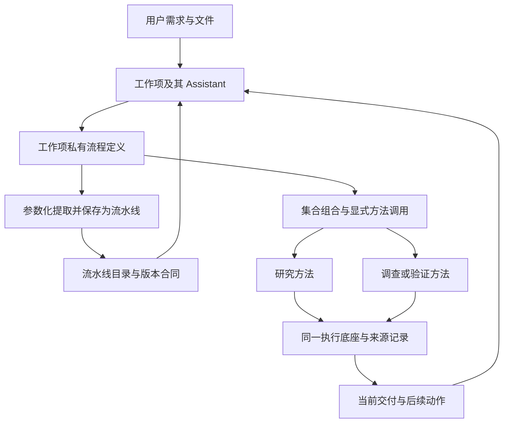

# 工作项驱动的元应用设计

日期：2026-10-28。状态：设计提案，供后续实现与验收使用。

实现选型、官方源码核查、隔离实验与一致性机制见[原语与动态界面实现调研](workitem-meta-implementation-research.md)。调研后明确区分 collect 的值收集与 barrier 的执行收口。

Flowcraft 帮助用户从一件具体工作的需求和材料出发，在页面内通过 Assistant 形成处理流程，调用已有方法，检查和组合结果，持续推进并形成交付。经过实际使用的处理流程可以提取成流水线，供新的工作项复用。

本设计从业务目标重新划分职责，不以当前未提交实现或历史数据兼容为前提。执行不变性、真实来源、失败可见和业务完成依据继续作为基本合同；原型优先实现最小可用闭环。

## 用户价值

用户获得的价值是完成事情：知道输入意味着什么、还有什么没处理、结果是否可信、接下来怎么做，并得到能够使用的成果。创建流程和生成界面服务于这条主线。

以本批 CVE 为例，最终要回答：

1. 本次审计覆盖哪些告警、仓库、版本和交付物？
2. 哪些仓库受到哪些 CVE 影响，依据是什么，哪些尚未查清？
3. 需要改动哪些仓库，具体改什么，哪些改动可以合并？
4. 修改后的产物是否经过验证，每条原始告警能否交代清楚？

用户已明确本次口径：每条告警得到修复或有证据排除，例外必须明确确认。阶段成果也有价值：范围清单、影响矩阵和改动计划可以先交付，未决部分持续可见。

## 元应用与具体工作的关系

元应用提供能够构建和推进具体工作的能力。它提供集合组合、方法发现与调用、输入和成果引用、界面组件、业务生命周期与执行记录。具体工作通过这些能力定义自己的处理方式和交付形态。

| 层次 | 核心职责 | 输入与输出 |
| --- | --- | --- |
| 元应用 | 提供流程语言、方法目录、Assistant 工具、组件目录及保存与执行能力 | 将具体工作的定义变为可操作页面和真实执行 |
| 工作项 | 持续维护一个业务目标的范围、材料、处理流程、当前交付、未决问题和完成依据 | 从具体需求与材料推进到阶段交付、完成或重开 |
| 方法与流水线 | 声明可复用的处理能力，包括输入、处理步骤、输出与效果 | 将明确输入变为可追溯的结果 |
| 执行 | 按固定定义和输入解释流程，保存实例、结果、失败、等待和恢复信息 | 产生一次真实执行及其不可变产物 |

这些是职责层次，不要求拆成独立服务。原型仍可由前端和单个后端直接协作。

业务规则放在具体方法和工作项合同中。应用提供关联、归并和展示能力，CVE 方法声明漏洞判断及审计成果字段；采购工作项可以使用同样能力声明报价与选型成果。

## 领域对象的职责

| 概念 | 负责什么 | 关键边界 |
| --- | --- | --- |
| 工作项 WorkItem | 本次业务身份、目标、范围、输入、当前流程、交付选择、完成条件及历史 | 可跨方法和多次执行；执行成功不自动结项 |
| 流水线 Work | 可复用方法的工作空间，保存标题、用途、样例、定义版本、编辑及运行记录 | 新工作项复用方法，使用自己的业务材料和状态 |
| 流程定义 Definition | 可保存、校验、编辑和执行的步骤、组合关系、输入输出及可选视图模板引用 | 工作项私有流程与可复用流水线使用同一种定义协议；视图内容独立版本管理 |
| 执行 Run | 固定输入与定义的一次处理，含调用关系、实例与产物 | 新材料、新流程和新版本不改写历史执行 |
| 输入与产物引用 | 标识真实原文、结构化值和不可变输出，保留版本及来源 | 引用原值，避免聊天摘要或浏览器副本成为执行依据 |
| 当前交付 | 工作项明确采用的成果组合、覆盖范围、视图声明和后续动作 | 是带版本的成果绑定；可组合多次运行，不能默认等于最新 Run |

“当前交付”先作为工作项中的少量绑定记录实现。原始内容继续保存在运行产物中，不建设另一套可变成果数据库。

## 上层流程与下层流程

上层流程组织本次工作：整理材料、拆分问题、选择方法、汇合结果、安排后续、交付与核对完成要求。下层流程完成一个相对稳定的处理任务，例如研究一个 CVE、核查一个目标、解析依赖清单或验证一次改动。

两者共享输入输出、集合运算、方法调用和执行语义。区别在处理范围与业务绑定：上层连接当前工作项的目标和材料；下层通过显式参数提供可复用能力。一个成熟上层流程也可以被另一个流程调用，不设永久的上下层类型。

采用一份可组合的 Definition 协议和一个执行底座。工作项流程增加显式的方法调用节点；调用固定版本的流水线定义，复用相同的调度、等待、停止、错误和来源规则。画布与 Assistant 编辑同一份定义，纯值变换继续采用有限表达式，不接受任意 JS 反向分析。



调用可以保存为关联的子 Run，记录父运行和调用实例。执行器统一管理调用树，不再为工作项建立另一套调度循环。停止传播到实际调用，试验效果传递给被调用流程；被调用方法的中断、失败和等待在调用处可见。

每次启动固定实际引用的定义版本和输入。有限动态展开将新调用版本在派发前固定到执行记录；不能在执行中跟随方法目录的“最新版本”。组合定义的递归调用应在校验时拒绝，避免形成无界调用。

子工作项的流程作为独立根 Run 使用同一执行器。父流程等待已声明的子项交付或完成事件时释放执行名额，子项可以继续。停止父 Run 默认停止它的调用树及本次等待，不取消独立子项业务或其执行；需要停止这些执行时使用明确的范围操作。父子业务归属不隐式决定启动、等待或停止范围。

工作项流程修订形成新定义。需要改动已启动图时，保留旧执行，并在明确停止或到达调整点后启动新执行；通过显式引用复用此前有效产物。调整点要求旧执行已经停止继续派发，新执行明确接管后续安排；未决外部操作先对账，避免两版流程同时执行同一业务动作。既有等待只接收其已声明的事件输入，不用补材料偷偷重写 Run 的初始输入。

## 从需求和文件开始

创建工作项只需要初始需求和已有材料。方法、详细流程、输入结构和完成条件可以逐步形成；信息不齐时保存真实缺口，并推进具备输入的独立部分。

第一项实际处理是整理可追踪的输入集合。集合可以只有一项，也可以通过解析产生多项。原始文件与整理结果分别保存；用户能够查看某条记录来自哪个文件、页段或上游产物。

```text
原始文件与用户描述
  → 识别目标和材料角色
  → 解析或调用方法抽取
  → 规范化为有身份和来源的对象集合
  → 发现重复、歧义与缺口
  → 用集合组织后续处理
```

规范化统一的是处理边界，而非所有业务字段。每项至少具有稳定标识、业务值、来源引用；适用范围、缺口和修订关系按需要附加。CVE 告警和采购报价的业务值各自遵循具体合同。

集合记录、执行实例和子工作项是三个不同概念。原型默认先形成集合并使用 map/flatMap 处理。需要独立责任、跨时间推进或单独验收时，才通过明确动作创建子工作项。

首次解析也在可执行流程中留痕。Assistant 可以先建立一段“整理输入”流程并执行，根据实际整理结果扩展后续流程。已有规范化输入可直接校验接入。无法解析的记录保留在缺口集合中，空输出必须能区分“明确没有对象”和“解析失败”。

### 输入如何跟踪

| 信息 | 保存目的 | CVE 示例 |
| --- | --- | --- |
| 原始来源及版本 | 返回真实材料 | 扫描报告及原告警编号 |
| 规范化身份 | 重排和重复读取不会产生另一条业务记录 | 告警 ID；重复告警关联同一调查对象 |
| 派生与修订关系 | 解释抽取、修正和替换 | 补充版本后形成新输入修订，保留旧值 |
| 实际消费关系 | 判断结果适用范围 | 核查实际使用的源码 commit、镜像标识和公告版本 |
| 当前采用关系 | 支持局部更新 | 采用补查后的 worker 判断，沿用 api 的有效判断 |

输入变化沿显式依赖标记相关成果待更新，指出哪些步骤可能重做。原型可以保守地标记受影响下游，再由用户或 Assistant 选择续做范围，不先建设透明缓存或通用增量计算引擎。

## 胶水原语的合同

集合组合处理明确的对象与来源，业务分析由 Agent 或具体方法完成。关系识别可以先由分析方法提出，确认后使用明确键关联；join 本身不做语义猜测。

| 原语 | 输入与输出 | 必须明确的规则 |
| --- | --- | --- |
| map | 每项输入产生一项结果 | 指定处理表达式或方法；保持输入身份与结果对应 |
| flatMap | 每项输入产生零到多项 | 显式拆分依据、派生身份和来源；零项仍保留处理回执 |
| filter / route | 按条件保留或分流 | 保留未进入分支的范围及原因，不能静默丢失业务责任 |
| join | 将两个集合按键关联 | 声明连接方式、重复键规则和未匹配输出 |
| collect | 将明确多路结果保留为具名集合或对象 | 保留空路、条目身份和来源，不承担隐式等待条件 |
| barrier | 收口某次分支展开的结果与状态 | 固定预期实例范围；完整收口等待选定分支终止，阶段交付显式选择已确定子集并声明其余范围 |
| groupBy | 按键形成有归属的分组 | 声明分组维度；保留组内身份和来源 |
| reduce | 将集合归约为一个值 | 显式初值、顺序和归并规则；空集合和冲突有定义 |
| 调用方法 | 端口输入进入一个固定 Definition | 固定版本、参数绑定、输出合同、业务效果与执行关联 |
| 请求输入或等待 | 明确缺口或已声明事件进入后续处理 | 区分材料不足与执行等待；标明阻塞对象和继续方式 |
| 建立子项 | 将候选处理单元变为独立 WorkItem | 保存目标、交接输入、范围、完成要求及防重标识 |
| 交付绑定 | 将真实产物组合成当前阶段交付 | 固定来源、覆盖范围、视图版本和可执行动作 |

map/flatMap 的分发方式与其内部处理分开配置：可以执行纯表达式，也可以调用方法。确定性的拼接、计数和分组由程序执行，只有需要理解和判断的步骤调用模型。

collect 表达多路值的组合，barrier 表达一次展开的执行收口。二者分开配置：先按预期实例确认结果与状态，再将可使用的值交给数据组合。多个入边不自动等于只汇总一次，部分失败与条件分支必须有明确范围。

reduce 返回 list 完全成立。多个 list 仅需拼接时使用 flatMap；需要分组、关联、合并或综合判定时使用 reduce。顺序归约不能被执行器擅自改成并行归约。模型综合判断使用普通分析方法，并保存其输入与输出。

### 最小错误与恢复合同

调用前发现输入合同不符时，定位缺字段和来源并保留选择，不启动一个注定无效的调用。部分失败保留成功实例。barrier 收口完成与全部成功分别表达：收口可以产出各实例的结果及失败状态，要求全部成功的后续调用受阻，明确接受缺口的阶段交付可以继续。未完成范围持续列出，失败状态不能伪装为成功业务值。

重复操作沿稳定输入身份、调用实例和建项回执恢复，避免重复创建业务身份。恢复复用已确定的结果；未知外部操作状态保留中断事实，不声称恰好执行一次。

## 流水线目录是工作项 Assistant 的必要输入

只暴露标题列表，Assistant 无法可靠连接方法。方法目录需要提供用途和可组合合同，并支持读取具体版本。目录不携带其他工作项的业务材料。

| 方法信息 | 用途 |
| --- | --- |
| 标识、标题、用途和适用边界 | 判断是否能解决当前子问题 |
| 可用保存版本及默认采用版本 | 检查时读取具体版本，调用时固定版本 |
| 具名输入、条目 schema、必填项、集合基数 | 绑定规范化对象，判断逐项或整批调用 |
| 具名输出、schema、基数和用途 | 连接下一步，区分中间值、报告和结构化结果 |
| 业务效果 | 区分纯读取、建立子项、改动文件等实际行为 |
| 等待、失败和恢复说明 | 正确安排后续及告知真实阻碍 |
| 小型样例及验证范围 | 理解调用方式，区分存在的方法与已验证的方法 |

发现与调用顺序为：搜索候选 → 读取具体合同 → 检查输入与业务用途 → 固定版本 → 保存调用节点与绑定 → 校验 → 按授权执行。列表和搜索解决发现，具体合同解决连接，真实运行解决本次是否成功。

合同不匹配时明确增加转换步骤，或进入方法作者上下文修改并保存新版本。找不到方法时，创建一个方法工作空间，通过同一套作者工具完成定义、校验和必要试验，再返回工作项连接调用。用户不必复制 ID、拼 JSON 或重新上传材料。

方法元信息先随定义或工作空间保存，由现有列表查询读取，不建设推荐平台、自动语义匹配系统或方法市场。

## 三种 Assistant 职责

| 角色 | 负责的范围 | 形成的正式结果 |
| --- | --- | --- |
| 工作项 Assistant | 理解目标与材料、发现方法、组织组合流程、调整安排、维护交付与未决问题 | 工作项流程修订、调用绑定、交付声明和明确业务操作 |
| 方法作者 Assistant | 在指定问题和输入合同内创建、修改并试验方法 | 可校验、可调用的 Definition 版本 |
| 执行 Agent | 完成固定节点要求的研究、调查、判断或生成任务 | 经合同校验的节点产物与真实执行记录 |

这是同一模型能力在不同上下文和工具集中的角色。执行 Agent 不临时承担整项调度；需要重组流程的发现作为结果返回工作项。工作项 Assistant 不把尚未执行的计划描述为实际结论。

### 工作项 Assistant 的职责规范

> 你负责将当前工作项的目标和材料组织为可持续推进的流程。先查看当前范围、输入、流程、方法目录、成果和未决问题，再执行实际修改。
>
> 首先形成可追踪的输入对象集合。依据原语合同组合流程，使用保存版本的方法处理具体问题，明确每条输入和每项成果的来源。信息不齐时记录具体缺口，推进可以独立处理的部分。
>
> 通过工具保存实际流程和业务操作，使页面能够查看、编辑和继续执行。依据真实产物更新当前交付及视图；说明计划、模型判断、已验证事实和人工确认的区别。
>
> 根据用户当前授权推进。用户要求创建流程时保存流程，要求开始处理时执行已明确安排；每个常规步骤不重复请求确认。必要的新决定在对应问题处呈现，失败和阻碍如实反馈。

### 最小工具面

以下是能力合同，不预设 HTTP 路径或 SDK 名称。工具可以合并实现，但必须覆盖这些实际读写行为。

| 工具能力 | 最小输入 | 可复核输出 |
| --- | --- | --- |
| 查看工作项 | 当前工作项、所需范围或对象 | 目标、修订、输入、流程、交付及实际状态 |
| 查看输入或产物 | 精确引用、可选分页范围 | 原值、版本、来源、内容预览或正文 |
| 发现流水线 | 用途查询或分页 | 候选方法摘要及保存版本 |
| 查看方法合同 | 方法标识与具体版本 | 输入输出、基数、效果及样例 |
| 保存流程修订 | 起点版本、结构化修改 | 新版本、校验问题、变更摘要 |
| 创建或编辑方法 | 明确任务、合同、样例引用 | 方法工作空间及保存定义；作者上下文可直接接续 |
| 试验或执行 | 保存定义、输入引用、试验或正式效果 | Run 引用及真实状态；长任务可后续查询 |
| 查看或控制执行 | Run 引用、停止或明确恢复动作 | 实际实例、结果、等待、错误与控制回执 |
| 提交交付或业务动作 | 成果引用、视图、动作或条件依据 | 保存后的交付版本、子项回执或条件变更 |

工作项会话是持续协作入口。关闭页面后已启动执行继续运行；重新打开时从保存的工作状态恢复。原型不承诺无人值守的无限规划循环：遇到未定义的业务决定时保存待处理问题，用户返回或主动继续时由 Assistant 接续。

## 稳定页面与动态业务界面

稳定页面承载工作身份、状态、导航、流程编辑、来源检查、错误反馈和业务确认。动态区域承载具体工作的问题模型、结果字段、输入表单、分组及后续动作。

固定四个主 Tab：成果、流程、输入、记录。Assistant 作为可收起的工作项侧栏，与当前选中的步骤、材料或结果共享明确上下文。用户直接操作和 Assistant 修改作用于同一份正式状态。

| 主 Tab | 稳定内容 | 由工作推进定义的内容 |
| --- | --- | --- |
| 成果 | 当前交付版本、覆盖范围、缺口、来源入口、完成要求及确认动作 | 表格、报告、矩阵、分组列表及业务后续动作 |
| 流程 | 组合图、实际状态、步骤检查、运行控制、方法查看与编辑入口 | 步骤、分支、调用、汇合条件和预期交付 |
| 输入 | 原始材料、规范化集合、修订和消费关系 | 对象字段、缺信息表单、身份匹配与范围确认 |
| 记录 | 输入与流程变更、运行、历次交付、结项与重开 | 每次实际发生的业务内容 |

页头始终保留目标、业务状态、当前阻碍和主要动作。首次没有可用交付时进入流程并提供开始处理；已有交付时进入成果。用户主动选择后保留位置，后台更新不抢走阅读。

### 动态界面合同

工作项可以声明多个成果视图。视图使用现有表格、报告、详情、分组列表、表单和动作控件组合；首版不执行模型生成的任意 React/HTML，不建设完整页面 DSL。

声明分开保存三个部分：

- 内容绑定：具体产物或交付中的数据路径，以及适用范围和版本。
- 视图描述：标题、视图种类、列、分组、章节、筛选和详情绑定。
- 动作描述：系统支持的实际操作、选中对象、输入引用和对应处理步骤或方法。

动作类型由应用提供，业务标签和参数由具体工作声明。每个视图中的记录选择传递稳定记录 ID 及其固定来源；筛选和重新排序不改变实际数据身份。执行动作时重新校验所选交付版本、来源和当前工作状态，旧视图不静默改用新结果。声明中不支持的组件或动作给出局部校验问题，并保留普通内容查看入口。

视图随工作项推进形成，可以从输入清单发展为影响矩阵，再增加改动计划和审计交付。顶层导航与运行状态语言保持稳定，业务视图不需要提前写入应用枚举。

视图修改不改变原始成果，也不自动修改结论。交付版本固定其使用的视图版本与产物引用；当前采用一个新视图或成果组合时保留前版。展示数量、模型置信措辞和执行成功率不能代替业务完成依据。

## 用 CVE 批次推演完整闭环

以下使用虚构漏洞 A、B、C 和仓库 api、worker、portal。三套待审计产物均有固定版本；审计范围尚缺 worker 的实际组件材料。示例值用于推演，不对应真实漏洞版本或修复结论。

### 开始与规范化

用户创建工作项，输入“查清本批告警影响哪些仓库，安排必要改动，并形成逐条审计依据”，附扫描文件、仓库清单和已有材料。

Assistant 查看方法目录，选择解析与核查方法，先保存并执行输入整理段。整理结果保留每条原告警，包括重复项和对象未匹配项。重复告警可指向同一个调查对象，但均保留返回审计交付的关系。

最少形成三个集合：原始告警、待审计对象、待调查关系。关系包含漏洞、组件、仓库/基线、构建或交付范围、来源和当前缺口。字段由本次 CVE 方法合同定义。

只有 CVE 编号而没有仓库范围时，先研究漏洞事实并请求范围输入；不能凭空生成“所有仓库已覆盖”。仓库清单存在但告警产物无法对应时，记录对象匹配缺口。

### 连接方法与并行调查

先按漏洞去重研究事实，再将事实与目标关系关联，对必要范围调用目标核查方法。规范化、关联、逐项调查和汇合集合都在同一流程中可见。

```text
原告警与目标清单
  → 规范化并保留来源
  → join 告警、组件、仓库与产物
  → flatMap 形成必要调查范围
  → map 调用研究或目标核查方法
  → barrier 确认各分支状态并保留失败与缺口
  → collect 收集明确采用的结果
  → flatMap 展开影响记录
  → groupBy 仓库、基线及发布范围
  → reduce 形成改动计划与未决工作
```

假设阶段证据得到下表。表中“排除”指存在适用于本次对象的依据，仍需按本次审计口径核对。

| 目标 | A | B | C | 当前动作 |
| --- | --- | --- | --- | --- |
| api | 受影响 | 受影响 | 有依据排除 | 检查共同修复方案 |
| worker | 有依据排除 | 有依据排除 | 待确认 | 补实际镜像组件材料 |
| portal | 有依据排除 | 有依据排除 | 有依据排除 | 核对排除依据 |

该阶段产生影响矩阵，可以使用和阅读；worker/C 仍然明确未决。六条排除、两条受影响和一条待确认只描述这个假设范围，不能推广到其他分支或产物。

### 从影响判断归并实际改动

假设 api 的 A、B 可以通过同一次依赖升级解决。Assistant 连接一个修复方案方法检查候选升级能否同时满足两个漏洞和当前依赖约束；reduce 负责将已确定的方案与覆盖关系归并。约束冲突时形成待解决冲突，不机械选择最高版本。

worker 补充材料后发现 C 来自共享基础镜像，镜像由 platform-images 仓库维护，worker 固定引用镜像版本。审计目标仍是原来的产物，实施计划新增必要的上游仓库；新增实施仓库不自动扩大审计对象。

| 改动仓库 | 工作内容 | 覆盖关系 | 执行依赖 |
| --- | --- | --- | --- |
| api | 升级依赖并重新构建 | api/A、api/B | 独立执行，分别验证两个问题 |
| platform-images | 修复镜像组件并发布新版本 | worker/C 的上游修复 | 先完成镜像修复与验证 |
| worker | 更新镜像引用并重新构建 | worker/C 的最终交付 | 使用已验证的新基础镜像 |

portal 无需制造代码改动，交付已核对的排除证据。此时“受影响仓库”和“需要改动仓库”分别呈现，两者通过影响与修复关系连接。

api 与基础镜像处理可以并行，worker 的后续更新依赖基础镜像成果。需要独立推进的整改建立子工作项；父流程引用明确交付或完成事件继续处理，不将父子归属树当作执行依赖图。

### 验证与审计交付

改动方案、实际变更、新构建和验证是不同产物。PR 合并不直接关闭告警；验证方法读取实际交付版本并生成固定证据。一个改动覆盖两个漏洞时，两个判断都需要相应验证依据。

原审计基线保持不变，修复后的产物作为它的后继交付，明确关联原始版本、实际变更和构建证据。验证另一分支或不相关产物，不能关闭原告警；修复后的关系在当前交付中表达，原始受影响判断仍保留。

本次审计每条原告警归入：已修复、有证据排除、已明确确认例外、尚未闭环。已修复需要关联变更及验证；排除需要适用范围和证据；例外需要确认记录；未匹配和未验证告警持续保留。

一条告警可以关联多个目标或范围，只有全部纳入关系都已有被接受的处理结果，该告警才闭环。不同关系分别修复、排除或确认例外时，告警总览显示“已闭环”并保留各关系的处理方式，不强塞进单一技术判断。例外绑定具体未满足要求和适用范围，不能用一次笼统确认跳过整批未决问题。

当前交付组合研究、核查、补查、改动和验证中的有效成果。最新 Run 可以只是补查 worker，不能覆盖 api 和 portal 的已有有效判断。新证据推翻判断时标记受影响交付待更新，保留此前确认。

完成条件是：纳入范围的每条告警均有被接受的处理结果，必要整改与验证已完成，例外已明确确认，剩余范围和交付材料满足本次约定。程序检查必要字段和引用，人工确认仍有实际业务意义；Run.completed 不自动代表审计完成。

### 本例的动态成果界面

成果 Tab 在本例形成三个视图，使用同一套固定交付内容：

| 业务视图 | 用户要回答的问题 | 关键字段与动作 |
| --- | --- | --- |
| 仓库影响矩阵 | 哪些仓库受哪些漏洞影响，哪里还不确定？ | 目标版本、漏洞、判断、依据、覆盖及缺口；查看证据、补输入、继续核查 |
| 仓库改动计划 | 究竟改哪些仓库，先后如何安排？ | 改动目标、覆盖漏洞、方案、依赖、实际变更与验证；启动处理、验证、查看后续 |
| 审计交付 | 每条原告警能否交代清楚？ | 原告警、审计对象、处理结果、固定依据和确认；核对、明确例外、检查并结项 |

发现缺少镜像材料时，按输入合同呈现镜像标识、构建记录和组件材料表单。业务视图可以新增字段和分组；真实来源、错误、选择与动作反馈沿用稳定交互。

## 将优秀工作流程保存为流水线

“保存为流水线”是一次参数化提取。它使用工作项已经明确的组合流程，生成可复用 Work 和 Definition，原工作项身份、输入与历史保持原样。

1. 选择要复用的流程范围，以及要保留的交付与视图声明。
2. 将当前文件、仓库、范围和审计口径等实例绑定提取为具名参数。
3. 保留 map/flatMap 等拆分规则，不把本次展开的全部实例固化成节点。
4. 固定被调用方法的版本，声明整体输入输出、业务效果和必要人工处理点。
5. 将当前可用输入作为样例，检查提取后仍保留对应处理与交付关系。
6. 保存到方法目录，新工作项可发现并调用整段流程。

提取时检查所有越过边界的数据、事件和业务上下文：历史产物、其他子项交付、人工输入、完成事件以及视图动作参数都需成为显式输入或声明依赖。无法参数化的绑定列为待解决问题，解决前不标记为可独立复用；视图和后续动作也不能残留本次实例引用。

可复用流程的业务写入目标来自调用时显式工作项上下文，不能留下原业务 ID。相同流程在试验中不创建正式子项或提交业务完成；正式调用按声明效果执行。

CVE 整批流程可以参数化为告警材料、目标清单和审计要求。下一批直接调用，特殊材料先通过规范化段接入；需要新处理方式时形成新版本，再按实际使用决定是否更新可复用方法。

## 最小落地路径

先围绕一个具体工作项走通，不先建设完整通用平台，也不为原型保留所有旧格式分支。

1. 打通“需求＋文件＋工作项 Assistant”。保存输入与会话，Assistant 能发现方法、整理对象集合并生成页面内真实流程。
2. 在同一 Definition 和执行底座中提供方法调用与必要集合组合。先用规范化、关联、逐项调用、收集和分组归并走通 CVE 影响矩阵。
3. 增加交付绑定及有限视图、表单与动作声明，贯通按仓库改动、补材料和验证。
4. 完成逐条告警验收、输入变化后的局部接续，以及关闭页面后的状态恢复。
5. 提取整批流程为流水线，使用另一批输入验证复用，再用一个非 CVE 场景检查业务语义是否仍留在具体方法与合同内。

流程的业务意义、IR 的集合含义和运行的错误边界先明确；具体类型名、存储路径和 API 划分在实施设计中按这条最短闭环确定。

## 验收与反例

| 路线 | 验收要求 |
| --- | --- |
| 无预先方法开始 | 只有需求和文件也能建项，Assistant 通过目录选择或创建方法，页面出现可编辑和可执行流程 |
| 输入身份与覆盖 | 重复告警可复用调查；重排不改变身份；未解析或未匹配告警不消失；空集合不冒充已处理 |
| 方法组合 | 每次调用有保存版本及明确输入；不匹配能定位并修正；调用内部状态可追溯和控制 |
| 多对多与整改归并 | 同仓同范围多个 CVE 可共用一次改动；不同分支或发布范围不被错误合并；每条覆盖关系保留验证要求 |
| 修复位置变化 | 共享镜像的修复可以引入原审计目标之外的实施仓库，影响对象与改动对象均可解释 |
| 部分失败与缺口 | barrier 收口真实实例状态；collect 组合实际值；全部成功要求阻断，允许缺口的阶段交付继续；补一项材料后只接续相关调查与必要汇总 |
| 当前交付组合 | 旧轮次有效结果与补查结果共同组成交付，最新局部 Run 不替换全部成果 |
| 动态界面 | 同一固定主导航承载不同业务视图；选择、筛选、来源和动作保持准确；改视图不改变结论 |
| 审计闭环 | 原告警的全部纳入关系均有接受结果才能闭环，例外绑定具体范围；验证必须对应原基线的实际后继交付，未验证改动不能显示为已完成审计 |
| 恢复与重开 | 关闭页面不丢已启动执行；恢复能看到流程、输入和当前交付；修订接管不会双重派发；停止父等待不取消独立子项；新证据不改写旧确认 |
| 提取复用 | 新工作项使用自己的材料与身份；外部数据、事件和动作绑定均被提取；保留拆分规则、方法版本和交付视图 |
| 非 CVE 复核 | 采购或客户问题使用同一组合能力形成自己的字段、视图与动作，无需新增 CVE 式通用业务枚举 |

这些是待实施的验收要求。模块校验、真实方法联测、真实模型、浏览器操作和用户视觉评价分别记录，不能相互替代。

## 与现有文档的关系

本提案给出本轮产品方向与职责划分；[当前设计](design.md)和[模块地图](implementation-map.md)继续描述已有系统，后续实施时按实际能力同步。历史 track 用作旧任务证据，不约束本轮必须兼容的形态。

[纯函数语义](functional-ir.md)与[多路组合](multi-input.md)提供既有集合语义参考；本提案扩展方法调用、上层流程、交付与视图合同，并将 barrier 执行收口与 collect 值组合分开，实施时需统一调用双方和编辑器说明。
