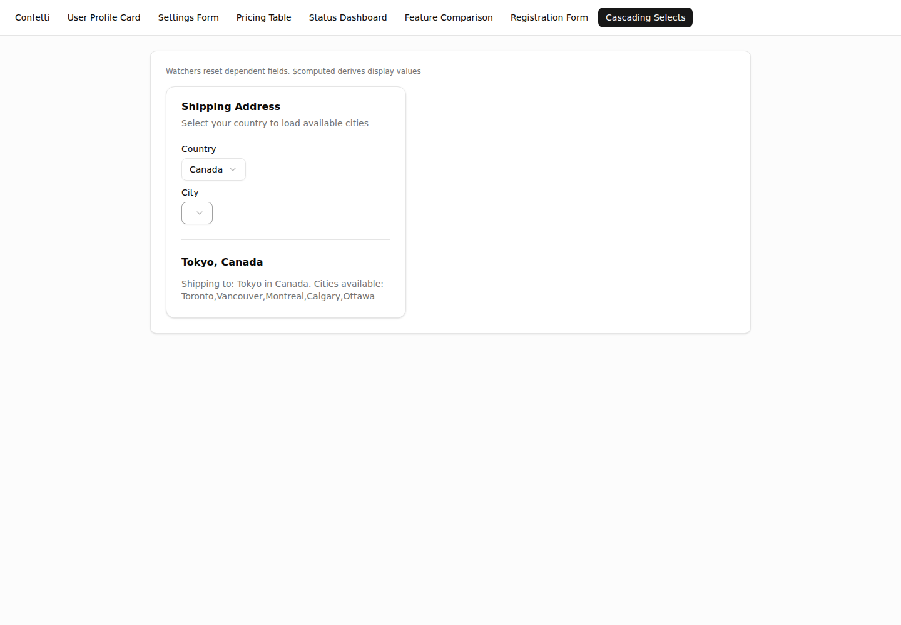

# 工作项原语与动态界面的实现调研

日期：2026-10-28。本文补充[工作项驱动的元应用设计](workitem-meta-application-design.md)，给出实现选型、合同边界和实验依据。后半部分为拟议实现，尚未接入产品。

## 实现结论

首版保留 React、React Flow、现有 Node 执行底座与 Pi 接入。工作项和流水线共享结构化定义，通过显式方法调用组合。原语、视图和动作分别维护小型能力目录，每个概念只有一份权威结构合同；画布、Assistant 和执行入口读取该合同。

动态 UI 选择 json-render 的 React Renderer、普通组件 registry 和受控状态接口作为接入方案，封装现有控件。项目维护正式 JSON Schema、Ajv 校验、Assistant 说明、业务引用和动作分发。该接法已通过源码与隔离 SSR 探针验证，正式采用仍需完成产品内浏览器接入路线。

一致性依靠共享结构合同、统一业务命令、版本固定和实际数据复核。schema 解决形状，引用检查解决对象与路径，执行器解决实例与等待，业务服务解决动作前提和验收。任何一层通过都不能替代其余层。

## 调研范围与证据

本轮阅读官方文档、下列固定版本源码及相关上游测试，另运行无模型小实验。没有安装依赖到项目、修改产品代码或连接托管实例。

| 对象 | 核查方式 | 用于判断什么 |
| --- | --- | --- |
| LangGraph Python 1.2.18 | 固定源码与实际派发、失败恢复、barrier、嵌套中断和跨进程恢复实验 | 分发、数据归并、执行收口与重执行边界 |
| Windmill OpenFlow | 官方规范及固定 Rust 类型源码 | 可保存的组合结构、子流程调用、独立运行状态 |
| json-render core/react 源码 manifest 0.21.3 | 固定源码、SSR 与流式解析探针 | 渲染接入、catalog 校验边界、状态与动作 |
| A2UI 当前 v0.9.1 | 固定规范、React/core 源码及上游测试审读 | 组件目录、消息、绑定、校验与发布机制 |
| JSON Forms | 官方文档、固定 reducer 与测试审读 | 数据合同和表单布局分离 |
| Ajv 8.20.0、现有 Pi Type 导出 | 实际结构校验与数据修改反例 | 同一 schema 复用的可行性与限制 |
| MCP 工具规范与 TypeScript SDK | 规范、handler 调用顺序及输入输出校验源码 | 工具协议校验与业务服务的边界 |
| json-render 公开无模型示例 | 独立无头浏览器实际操作与截图 | 数据绑定和联动字段的可观察行为 |

固定源码：

- json-render：`c6f73d7d5f69acb80fc89faefd12c0865c8603d1`。
- A2UI：`ccf5dc20d0b0ed041b03e3913d807420ff45e178`。
- JSON Forms：`2c5fae62a8aace19970ac037d122fa6428cd0436`。
- LangGraph：`eb8ec111b3e9d3108af5d7bdcac51e3e913637a0`；所查 `graph/state.py` 与安装包文件 SHA256 相同。
- Windmill：`c858cd1d14bdccdff2dc185f1424886c85623ce2`。
- MCP TypeScript SDK：`39ae8e6192cf43273aaaf2de4169dfa9f7216e28`，与本轮审读的 mcp.ts 文件逐字相同。

实验脚本、输出、版本及复现说明见[证据目录](evidence/workitem-meta-research_20261028/README.md)。公开示例是访问当日部署，不能假定与固定源码 SHA 相同。

## 工作流调研带来的语义修订

### 数据归并与执行收口必须分开

LangGraph 的 Send 在运行时派发既定节点的多个实例；state reducer 合并某个状态字段的更新。它们不能自动决定业务记录身份、整改归并或覆盖范围。[Graph API](https://docs.langchain.com/oss/python/langgraph/graph-api)

实跑不同长度的两条分支，分别连入 collector 会执行两次；指定全部前驱的 list edge 执行一次，但若条件未选择其中一个前驱，collector 零次且不报错。defer 可延迟到全图没有 pending 任务，也不等于局部展开收口。[并行执行说明](https://docs.langchain.com/oss/python/langgraph/use-graph-api#defer-node-execution)、[固定 barrier 实现](https://github.com/langchain-ai/langgraph/blob/eb8ec111b3e9d3108af5d7bdcac51e3e913637a0/libs/langgraph/langgraph/graph/state.py)

因此修订原设计中的 collect 命名：

| 名称 | 本项目语义 |
| --- | --- |
| map / flatMap | 流程级分发，实例化有限任务；内部可以调用纯表达式或方法 |
| 值级 map / reduce | 操作节点内的 JSON 集合，普通确定性变换 |
| collect | 把明确的多路值收集成具名集合或对象，保留空路 |
| barrier | 等待某一次展开的明确实例集合结束，生成结果与状态收口 |
| join | 按业务键连接数据，不承担执行等待 |
| 业务验收 | 按目标核对交付和依据，不从 barrier 或运行成功推断 |

barrier 记录 `expansionId + expectedInstanceIds`，按实际展开的实例收口。每项具有 succeeded、failed、cancelled 等真实状态，不能仅比较输出条数。空展开明确结束；未执行、失败和明确排除分别表达。

默认完整收口后再调用要求成功集合的方法。阶段交付可以明确选择已确定子集，并列出其余范围；不会把异常改造成合格业务值，也不反复触发同一份最终交付。

### 恢复需要保存实例结果和业务操作回执

LangGraph 实验中三个 Send 有一个首次失败，恢复后的调用次数为 1、2、1，成功项未重跑。成功输出可以通过 get_state 投影看到，原始 checkpoint 与 pending writes 又分别保存信息。应用应消费明确的实例状态和结果引用，不能只依赖一个扁平汇总状态。[持久化说明](https://docs.langchain.com/oss/python/langgraph/checkpointers)

嵌套 interrupt 恢复时父 wrapper 执行两次，已完成子步骤一次，interrupt 所在步骤的前缀两次。普通副作用发生两次，包成已保存 task 结果后为一次；两个独立进程使用 SQLite 也成功恢复。这不证明外部成功但回执未落盘时恰好一次。[嵌套中断规则](https://docs.langchain.com/oss/python/langgraph/interrupts#using-with-subgraphs-called-as-functions)

因此建立子项、启动方法和提交交付使用稳定操作身份与保存回执。恢复先检查实际记录；源码变更、流程版本和外部操作状态分别核对。Python 版验证不能当作 Node 版 LangGraph 的接入证据，本轮不据此迁移执行框架。

### 可保存流程与运行状态分开

Windmill OpenFlow 有 flow、forloopflow、branchone、branchall 等可保存模块及输入变换；运行状态另外记录实际子 job 和成功失败。该结构支持本项目的“定义保留组合规则，运行记录实际展开”。[OpenFlow 规范](https://www.windmill.dev/docs/openflow)、[固定流程类型](https://github.com/windmill-labs/windmill/blob/c858cd1d14bdccdff2dc185f1424886c85623ce2/backend/windmill-types/src/flows.rs)、[运行状态](https://github.com/windmill-labs/windmill/blob/c858cd1d14bdccdff2dc185f1424886c85623ce2/backend/windmill-types/src/flow_status.rs)

源码中 for-loop 的 skip_failures 默认开启，不能照搬成业务覆盖规则。Flowcraft 即使继续执行，也必须保留失败输入的去向。Windmill 整个平台与任意脚本编排不作为本轮依赖。

## 动态界面调研与接入选择

### json-render 适合复用渲染层

json-render 将组件、props、子节点、数据绑定和命名动作表达为结构化 spec。普通 ComponentRegistry 与 Renderer 可以独立使用，JSONUIProvider 支持 controlled store，组件可以直接包装现有 React 控件。[registry 文档](https://json-render.dev/docs/registry)、[固定 Renderer 接口](https://github.com/vercel-labs/json-render/blob/c6f73d7d5f69acb80fc89faefd12c0865c8603d1/packages/react/src/renderer.tsx)

隔离 SSR 探针没有创建 Zod props catalog，仅使用普通 registry、项目 Ajv schema 与明确提供的 fixture state，成功渲染绑定内容；非法 resolved props 被同一 Ajv 合同拒绝。该实验尚未接入真实落盘成果，支持的是渲染层接口可行，不再手写一套 Zod 业务合同。

首版只开放表格、报告、详情、分组列表、表单和动作等有限组件，组件实现使用现有控件与视觉 token。主导航、流程编辑、来源检查和业务状态由稳定页面承担。

### 不能将 catalog 或 renderer 当作完整校验器

在固定版本的实际探针中：

- 多组件 catalog 接受了 `Text.content = 123` 及额外字段，结构校验同样通过；单组件 catalog 会拒绝。
- Renderer 直接输出了错误 props 对应内容，没有自动按组件合同检查。
- `catalog.validate(spec).data` 删除了未在该 schema 中声明的 state、on、watch，原始绑定能显示真实值，使用返回 data 后显示缺失。
- `executeAction` 将数字 recordId 原样交给声明要求字符串的 handler。
- 流式 compiler 能缓冲跨 chunk 的行，但也会忽略无效完整行，截断末行不会自动使整份视图失败。

这些结论限于固定源码和探针，不概括所有版本。对应[propsOf 实现](https://github.com/vercel-labs/json-render/blob/c6f73d7d5f69acb80fc89faefd12c0865c8603d1/packages/core/src/schema.ts)、[React schema](https://github.com/vercel-labs/json-render/blob/c6f73d7d5f69acb80fc89faefd12c0865c8603d1/packages/react/src/schema.ts)、[registry 动作实现](https://github.com/vercel-labs/json-render/blob/c6f73d7d5f69acb80fc89faefd12c0865c8603d1/packages/react/src/renderer.tsx#L1170)。

该版本默认 prompt 还要求生成 realistic sample data，customRules 是追加规则。真实成果需要绑定服务器数据，不能直接使用这个默认 prompt。[默认规则源码](https://github.com/vercel-labs/json-render/blob/c6f73d7d5f69acb80fc89faefd12c0865c8603d1/packages/react/src/schema.ts)

### 浏览器反例说明联动字段也需要校验

在[官方无模型示例](https://no-ai-demo.json-render.dev/)中实际完成表单输入修改和国家城市联动：Japan/Tokyo 能正确显示；随后选择 Canada，选项已变成 Toronto 等城市，但计算文本仍保留 Tokyo，显示“Tokyo, Canada”，且没有 pageerror。



这只证明该部署在访问当日的这条交互路径存在不一致，不能据此判定所有 renderer 都有同样问题。它足以说明：响应式绑定、下拉选项变化和不抛异常，均不能证明业务值一致。本项目需要在输入修订和业务动作入口校验字段间的关系；联动失败时保留草稿并指出问题。

### A2UI 与 JSON Forms 的取舍

A2UI 当前规范为 v0.9.1，v1.0 是 candidate；已有 React 实现、组件目录、消息处理、绑定及动作回传。固定 core 源码按具体组件执行 payload 校验，并有整批更新失败不修改模型的测试。[固定规范](https://github.com/a2ui-project/a2ui/blob/ccf5dc20d0b0ed041b03e3913d807420ff45e178/specification/v0_9_1/docs/a2ui_protocol.md)、[payload 校验](https://github.com/a2ui-project/a2ui/blob/ccf5dc20d0b0ed041b03e3913d807420ff45e178/typescript/core/web_core/src/validation/payload-validator.ts)、[message processor 测试](https://github.com/a2ui-project/a2ui/blob/ccf5dc20d0b0ed041b03e3913d807420ff45e178/typescript/core/web_core/src/processing/message-processor.test.ts)

首版是单个 React 产品，选择较窄的 renderer 接口，暂不引入 Surface、消息处理与协议协商全套。A2UI 的协议版本、组件 ID 同样不代替业务记录身份和交付版本。需要跨客户端互操作时再评估完整接入；未运行 A2UI 产品级实例。

JSON Forms 成熟地区分 data schema 与 UI schema，并在数据更新时使用 Ajv。它适合复杂补输入表单，不足以承担工作项的全部成果与动作语义。首版使用现有控件与同一字段合同，复杂嵌套表单实际出现后可封装 JSON Forms 为单个组件。[UI schema](https://jsonforms.io/docs/uischema/)、[验证](https://jsonforms.io/docs/validation/)、[固定 reducer](https://github.com/eclipsesource/jsonforms/blob/2c5fae62a8aace19970ac037d122fa6428cd0436/packages/core/src/reducers/core.ts)

## 原语如何实现

### 每种原语只有一份结构和语义入口

在 shared 的流程合同旁放置小型原语描述与结构 schema，沿用现有 Type/JSON Schema 和 Ajv。共享元数据包含 kind、配置 schema、端口及基数、效果、简短说明和样例；执行 handler 留在服务端，React 控件留在前端，不让 shared import 双方。

不从一份 schema 自动生成所有业务逻辑。配置结构、端口规则与语义约束是不同内容，分别由具名函数表达，并被所有入口共同调用。编辑器可以保留不完整草稿，启动必须经过完整准备检查。

```text
原语描述与 schema
  ├─ Assistant 的能力说明、工具参数和样例
  ├─ 画布节点类型、端口、配置字段与帮助
  ├─ 服务端结构与组合校验
  └─ 按 kind 分派的服务端执行 handler
```

| 原语 | 执行核心 | 明确检查 |
| --- | --- | --- |
| map / flatMap | 有限展开为可追踪实例；每项调用方法或表达式 | 稳定输入身份、派生标识、并发范围、输出基数 |
| call | 固定方法版本，调用同一执行底座 | 方法存在、具名端口、实际输入、效果与父实例关联 |
| barrier | 保存展开范围，收口预期实例状态 | 空展开、未执行、失败、取消、只收口一次 |
| collect / join / groupBy / reduce | 普通确定性集合函数 | 键、重复、空集合、顺序和来源；不做隐式语义判断 |
| request-input / wait | 保存具体缺口或声明事件 | 输入与事件修订、继续目标、停止后迟到消息 |
| 业务效果 | 调用工作项已有业务服务 | 操作身份、当前 revision、前提与保存回执 |

首版不新建编译平台。启动准备读取定义、解析调用版本与引用、检查组合、固定输入后交给同一执行器。后续如需执行计划优化，再依据真实性能问题增加。

现有源码中 `shared/records.ts`、Assistant 的 definitionSchema、`node-ports.ts` 和执行分派各有合同片段。实施时把共同结构与端口元数据收敛，保留专属语义函数，避免新增一种原语时靠人工同步多个枚举。

## UI 编排如何实现

### 分开内容引用和视图定义

ViewRevision 保存 catalogVersion、spec、逻辑数据源和动作绑定；交付版本把这些逻辑数据源绑定到不可变实际产物。流程产出结构化数据，视图读取数据。视图调整产生新 ViewRevision，不改变流程定义或旧运行。

例如本例的影响矩阵是一种普通 RecordTable，配置列和选择动作即可。下面是接入层示意，不是现有 API：

```json
{
  "root": "impact",
  "elements": {
    "impact": {
      "type": "RecordTable",
      "props": {
        "rows": { "$state": "/data/relations" },
        "rowKey": "id",
        "columns": [
          { "field": "repository", "label": "仓库" },
          { "field": "cve", "label": "CVE" },
          { "field": "assessment", "label": "影响判断" }
        ],
        "selection": { "$bindState": "/selection/impact" }
      },
      "on": {
        "continue": {
          "action": "continue_records",
          "params": { "recordIds": { "$state": "/selection/impact" } }
        }
      },
      "children": []
    }
  }
}
```

RecordTable 由应用实现，选择值是稳定记录 ID，不是行下标。catalog 的 schema 描述合法 props、事件和解析后的动作参数；Assistant 可以改变列、标签和分组，不能填入业务结果或任意 HTTP 地址。

### 两阶段校验和受控状态

保存前检查组件类型、props 的字面量或绑定结构、子节点与 slot 引用、循环和重复 ID、可用事件与动作。能确定的数据路径和列字段立即检查；未来运行数据只能在实际到达后验证，静态通过不代表数据一定存在。

渲染前解析绑定，再对 resolved props 用相同组件 schema 校验。缺少可选值按声明呈现“待取得”等真实空态；缺少必要值局部报错，提供来源与普通内容查看，不制造默认业务判断。

状态分区：`/data` 是服务端当前交付的只读投影，`/draft` 保存尚未提交表单，`/selection` 保存当前视图选择。受控 store 拒绝向 /data 写入，表单提交后由服务端保存新输入并重新发布正式状态。

json-render 的内建 setState 等动作先于自定义 handler 处理，因此仅限制 handler 名单不够。首版 validator 禁止直接修改正式业务状态的本地动作、任意 watcher、任意 computed 或自动触发动作；业务操作只允许绑定已注册命令，需要的本地输入更新由受控组件实现。业务计算仍通过方法产生，简单显示格式由固定组件处理。[固定动作分发](https://github.com/vercel-labs/json-render/blob/c6f73d7d5f69acb80fc89faefd12c0865c8603d1/packages/react/src/contexts/actions.tsx)

流式 spec 只在隔离草稿中预览，业务动作禁用。接收完成并通过全部检查后一次发布；流结束本身不代表成功。首版可以整份提交 spec，降低半成品状态的复杂度。

### 组件目录的规模

第一版只做 RecordTable、Report、RecordDetail、RecordGroups、InputForm、ActionBar，加少量布局与状态组件。它们包装现有 shadcn、表格和阅读器。每条记录都保留打开来源的能力，大集合仍走分页查询，不生成成千上万个静态元素。

可复用方法同时保存输出合同与视图模板；新工作项调用时重新绑定真实产物。工作项可以覆盖展示，旧交付保留固定视图版本。

## 如何避免入口之间不一致

### 共享 schema 只解决一部分问题

实测现有 Pi Type 导出可以生成直接交给 Ajv 的 schema；合法 groupBy 配置通过，空 keys 被拒绝。另一个形状合法的不存在业务路径仍被 Ajv 接受。启用 coerceTypes/removeAdditional 时，字符串数字被转成数字，额外字段被删除。[TypeBox](https://github.com/sinclairzx81/sinclair-typebox)、[Ajv 数据修改说明](https://ajv.js.org/guide/modifying-data.html)

正式校验使用纯校验，不自动改值。结构转换作为显式流程步骤。业务 schema 与组件 schema分别只有一份权威定义，Assistant 参数、前端检查和服务端检查从它生成或直接引用，不再维护第二份 Zod/TS 手写合同。

### 所有正式变更进入同一业务命令

```text
画布编辑 / Assistant 工具 / 动态 UI 动作
  → 相同 command 输入合同
  → 读取当前工作状态并检查 revision
  → 解析真实引用、方法版本和所选记录
  → 检查组合与业务前提
  → 在副本上形成新状态并校验
  → 保存，返回真实 revision、操作及结果引用
```

外部工具协议、前端禁用状态和本地 schema 都不能绕过该入口。UI 不直接改状态字段，Assistant 也不写另一套“计划结果”。MCP 高层 SDK 执行输入校验后调用 handler；声明 outputSchema 且返回成功完成结果时校验输出，错误或 input-required 中间结果跳过最终输出校验。应用自己的业务前提仍由 handler 实现；项目内工具不需要先改造成 MCP 服务。[MCP 工具规范](https://modelcontextprotocol.io/specification/2025-11-25/server/tools)、[固定 SDK 源码](https://github.com/modelcontextprotocol/typescript-sdk/blob/39ae8e6192cf43273aaaf2de4169dfa9f7216e28/packages/server/src/server/mcp.ts)

### 编辑并发与发布

每次变更携带 baseRevision。单进程文件方案在短临界区内重读、比较、校验和替换；不持锁等待模型或整个运行。冲突返回当前版本与具体问题，用户或 Assistant 重读后重新决定。

启动方法等异步动作先保存稳定 operationId 与操作意图，再在锁外执行并保存回执；恢复时按实际运行和业务记录对账。CAS 保护状态提交，不提供外部副作用恰好一次保证。

流程与视图需要共同修改时，提交同一变更组，验证它们之间的引用后一起更新工作项指针。不可变定义可先写文件，最后原子切换已校验的绑定；未被采用的文件不算保存成功。仅调整视图不改变执行定义，移动节点也不改变语义版本。

第一版采用完整结构化对象或有限业务修改，配合 baseRevision。无需先引入通用 JSON Patch 编辑语言。若后续使用 patch，test 操作仍需与最终保存处在同一临界区，不能假设第三方库原地失败后会自动回滚。[RFC 6902](https://www.rfc-editor.org/rfc/rfc6902.html)

### 执行与动作版本

运行固定 Definition、方法版本和输入快照；交付固定结果引用和视图版本。记录身份与组件 ID 分开，filter/sort/page 只改变可见集合，不重写 ID。

动态动作由适配层补入实际 workItemRevision、deliveryId 和 viewRevision，提交 actionId、稳定 recordIds 及表单草稿。服务端重读交付、记录和动作绑定，按当前状态重新检查。拒绝过期或越界选择；不能让旧界面悄悄作用于新结果。

json-render 的 repeat key 可以使用 id，但缺失时回退 index，双向绑定也可能仍使用数组下标。业务表格必须要求明确 rowKey，提交时使用来源中的业务 ID；React key 本身不能作为业务引用保证。[固定 repeat 实现](https://github.com/vercel-labs/json-render/blob/c6f73d7d5f69acb80fc89faefd12c0865c8603d1/packages/react/src/renderer.tsx#L859)

## 提供给 Assistant 的具体支持

Assistant 获得职责说明、可执行能力目录、方法版本合同、当前业务上下文、实际检查工具和结构化错误。只给自然语言 prompt 不足以形成可靠闭环。

| 支持 | 具体内容 |
| --- | --- |
| 职责规范 | 何时整理输入、如何组合方法、如何保留来源、哪些动作构成业务变化 |
| 原语目录 | 配置 schema、端口与基数、确定性含义、效果、空输入/失败样例 |
| 组件与动作目录 | 真实可渲染组件、props/事件、绑定规则、合法命令与参数 |
| 方法发现 | 用途检索、版本列表、完整输入输出合同、效果及样例；不只有标题 |
| 工作上下文 | 当前修订、目标、范围、输入 schema 和预览、流程、实际执行、交付及缺口 |
| 检查与预览 | 校验流程和视图、读取必要样例、试验明确范围并查看真实输入输出 |
| 正式操作 | 保存定义、调用方法、停止/恢复、提交交付及业务操作，均返回真实回执 |
| 修复反馈 | code、对象 ID、字段路径、原因、期望、实际情况和当前 revision |

能力说明由项目的 schema、端口函数和组件/动作元信息生成，人工编写职责和业务示例。固定样例包含合法组合、错端口、基数不符、缺输入、失败收口和旧视图动作，避免只展示理想输出。

典型工具族为 inspect_work_item、read_artifact、find_methods、inspect_method、describe_capabilities、check_proposal、save_proposal、execute、inspect_run、submit_outcome。工具名只是实施建议，正式参数必须引用同一结构合同。

check_proposal 返回的诊断例如：`VIEW_FIELD_MISSING / elements.impact.props.columns.2.field`、`METHOD_INPUT_MISMATCH / nodes.check.inputs.targets`、`REVISION_CONFLICT`。保存与执行仍重新校验，先前一次 check 不是永久许可。

正式结构工具使用模型支持的 JSON Schema 子集投影；不支持的约束保留在服务端完整合同中。说明该差异，并在错误回传中给出实际约束，不能为适配工具 schema 而放宽正式业务校验。

## 模块落点与实施顺序

这是后续实施边界，不要求立刻移动现有所有代码。

| 模块 | 具体职责 |
| --- | --- |
| shared 的流程及展示合同 | 小型 schema、原语/组件/动作元信息、引用与错误类型 |
| server/flow | 结构与组合检查、调用合同解析、启动准备 |
| server/runs | 同一调度器中的调用、展开、barrier、结果、停止与恢复 |
| server/work-items | 业务命令、revision、输入修订、交付与完成依据 |
| server/assistant | 从合同生成工具和说明，绑定工作项上下文与错误回传 |
| client/features | 画布投影、配置、稳定四 Tab、受控 renderer 适配与真实动作 |

先完成一个最小纵向切片：输入整理 → map(call 固定方法) → barrier → collect/groupBy/reduce → 发布 RecordTable → 选择记录继续处理。画布和 Assistant 必须分别创建或修改它，并得到同一运行行为。

随后加入补输入表单、部分失败、视图修订和局部接续，再走完整 CVE 整改与审计。最后提取为流水线，用新工作项和非 CVE 材料验证复用。这样每阶段都产生用户可使用的结果。

## 一致性验收必须覆盖的反例

| 反例 | 必须观察到的行为 |
| --- | --- |
| 多组件 spec 形状合法但某个 props 类型错误 | 逐组件检查拒绝；绑定解析后的错误同样拒绝 |
| 字符串路径合法但成果字段不存在 | 引用检查定位问题，不生成默认结论 |
| 模型生成业务样例数据 | 正式视图拒绝，真实 /data 只来自绑定产物 |
| 原语在编辑器、工具、执行器之一缺失 | 能力覆盖检查失败，不暴露半支持原语 |
| 不同长度分支汇合 | 按固定展开实例收口一次，不凭多个入边重复发布 |
| 一项失败或条件排除 | 成功结果保留；失败与未选分支区分；全成功要求阻断 |
| 表格过滤、排序或分页后点击动作 | 仍操作原选中 ID，不按可见位置解析 |
| 修改仓库、分支或产物后沿用旧的从属字段 | 表单或业务校验指出不适用关系，不能静默提交 |
| 两个入口从同一旧 revision 修改 | 只有一个成功，另一方收到冲突并保留提案 |
| 流式传输截断或引用尚不完整 | 草稿可查看，正式发布和业务动作受阻 |
| 视图已换版或交付已更新后点击旧按钮 | 明确拒绝或重新准备，不替换成新目标执行 |
| 中断恢复重进包装步骤 | 不重复建项或提交交付，未知外部结果先对账 |

本轮已验证部分第三方机制和上述边界反例，不代表这些产品验收已经通过。正式接入还需 Node 22 基线、浏览器中的组件状态与分页、真实 Pi 结构化工具调用，以及一次用户认可的 CVE 路线。
