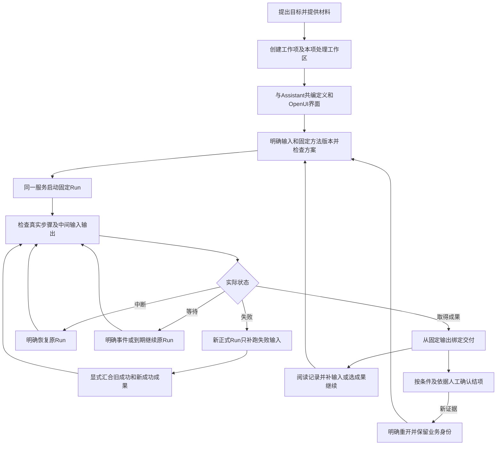

# 唯一工作项处理流程与 OpenUI 集成

2026-10-30，用户已确定并正在实施的业务合同。实际进度见[track计划](../conductor/tracks/overall-design-workitem-openui_20261030/plan.md)。

本设计替代当前方法/输入双轨、resultOutput专用成果引擎，以及“OpenUI仅用于解析、json-render负责展示”的取舍。采用OpenUI正式框架，保持单进程、本地文件和同一个业务运行器。允许删除退役代码与业务数据，默认重建原型数据，不要求兼容迁移。

## 业务界面的目的与最小边界

Assistant能编排具体工作，用户必须能看见并参与它的业务推进。界面贯穿处理前、处理中和最终成果；业务阶段不等于一次Run的节点状态，交付不是唯一数据来源。Assistant根据当前工作决定关注字段、统计、分组、详情、表单及动作；应用提供真实事实和业务命令。OpenUI只承接描述/渲染/交互，assistant-ui承接聊天。

读取复用本项workspace（stage/summary/blocker/nextAction/execution）、现有子项summary分页及统计、指定Run的实际阶段输出、固定Delivery。少量数据绑定构件展示字段、统计和清单；不在内核写CVE/客户反馈等业务页面或猜测业务完成率。可变事实从读取结果呈现，解释文字不复制状态。阶段输出可观察，不因此成为已发布交付；继续处理仍需明确来源。

例如无子项的资料核对可同时显示当前业务阶段、已核对的阶段记录/待确认点及补充入口；有子项的工作可按实际关心的维度展示子项和统计，再查看某项。最终交付沿原固定来源呈现，字段和业务名称由同一界面描述决定。

## 1. 唯一业务主线

1. 开始只要求目标和材料，应用创建业务身份及其私有处理工作区。首页提交请求规划，不能悄悄正式运行。
2. Assistant阅读实际材料、输入、方法目录和已有成果，与用户修改同一Definition。公共方法通过固定版本call应用；调用实例不是独立子工作项。
3. Assistant安排实际需要的阅读、表单和推进动作，保存OpenUI程序。用户可指向具名片段修改；组件、字段、方法和动作来自真实目录。
4. 单一准备服务解析当前输入绑定、固定定义及来源。人、Assistant、批次和界面操作调用同一启动服务，失败保留草稿并给出明确回执。
5. 执行中可检查步骤、实例和中间产物。正式交付引用明确的成功正式Run输出，模型描述、预览及占位值不成为成果。
6. 修订保存新输入版本；选记录续做由服务器重读固定记录，保存来源并统一准备执行。旧成果仍可查看，明确标为此前输入/方法。
7. 用户按真实依据确认条件并主动结项。Run.completed不结项；重开仍是同一WorkItem。

## 2. 唯一权威模型

下表是目标字段合同；实施时同步双方与存储，不同时留下新旧可写字段。

| 对象 | 唯一负责内容 | 目标关系 |
| --- | --- | --- |
| WorkItem | 业务编号、目标、材料、条件、历史、当前处理关系和交付 | 一个`workId`、一份`inputBindings`、一个`deliveries[]`，引用当前`uiProgram`；业务open/completed与运行状态分开。 |
| Work | 方法工作区、定义版本、布局、Run及Assistant会话 | `ownerItemId`区分私有/公共工作区。公共方法可保存与固定Definition关联的OpenUI模板，显式复用时复制为本项程序，此后不双写或跟随模板。 |
| Definition | 有限业务计算图、端口、操作、输入/输出schema和固定方法引用 | 不可变版本，修改产生新版本；布局独立。 |
| Run / NodeResult | 本次固定定义、输入、材料、实例、等待、事件和来源 | 所有入口同一冻结规则；恢复只用本次上下文，不从当前Work倒取业务输入。 |
| OpenUI程序 | 人和Assistant共编的业务界面安排 | `WorkItem.uiProgram={id,definitionId,source}`为唯一当前可写表示，source为原生OpenUI Lang；解析树、视图索引和库规范均只读派生。 |
| Delivery | 明确发布的业务输出及展示版本 | 固定`workId/runId/definitionId/output`、界面程序版本及可选只读`recordContract`；多视图可引用同一Run。展示换版与业务数据换版分开。 |

删除`workflowId/lastRunSelection`驱动的另一条当前推进路径；`compositionWorkId/compositionInputs`一次改为上表名称，删除`delivery`单数别名。历史身份/输入已由ItemRunRef和Run保存，不用可变“上次选择”作为当前权威。

材料与received输入继续有明确来源。修订保留replacesId并更新唯一绑定；当前绑定改变不改写旧Run。客户端不能通过复制正文、同名字段或“最新成功Run”建立隐式接续。

可选记录组件在已保存OpenUI程序中声明逻辑output和顶层rowKey。发布服务从该程序派生记录合同，验证真实记录集合为对象数组、编号为非空唯一字符串，并将rowKey冻结为Delivery.recordContract。嵌套业务输出先由Definition中的普通函数显式投影，不在通用前端猜记录路径。客户端只提交deliveryId和recordIds，不能另传rowKey或记录正文。展示标签/布局换版不改变记录身份；改变output/rowKey属于新绑定，不能沿用旧选择。此合同是固定来源的只读快照，不是第二份可写界面计划。

## 3. OpenUI正式框架接入

### 3.1 采用方案

使用`@openuidev/lang-core`与`@openuidev/react-lang`的组件库、官方Renderer、prompt/schema生成、响应式表单和具名合并能力。当前core/react-lang均为1.0.2；框架接入不代表全过程业务界面已完成，重做状态见track。

保留现有assistant-ui及Pi生命周期。对话中的界面预览和工作项主内容共用同一库/Renderer；主内容读取服务端保存的当前程序，历史聊天界面不成为另一份当前业务安排。首版不新增需要人类工具回调才能恢复的Assistant等待协议，用户提交后沿现有会话发起下一次请求即可。

组件库声明一次，使用官方defineComponent/createLibrary，复用现有shadcn控件、表格、材料/成果阅读器及来源能力，加入必要布局组件。官方库描述生成服务端prompt/schema，生成文件不独立编辑。删除自建组件解释器、AST求值器和json-render编译链。

### 3.2 数据和交互

- OpenUI程序保存布局、具名组件与读取/动作接线，不内嵌成果正文。Query读取本应用明确的工作区、固定记录和产物接口，大值按需/分页读取。
- Mutation及原生动作序列调用本应用的具体业务命令。提交成功后刷新读取；失败保留表单和选择。挂载、预览、刷新及轮询不得执行业务写入。
- `@ToAssistant`通过统一requestAssistant进入当前会话，带工作项、当前关注片段和明确记录引用；普通浏览不调模型。
- `$variables`只承载表单、选择、搜索等界面状态；业务计算和长时等待仍在Definition/Run，界面变量不成为业务真值。
- Renderer的toolProvider只适配明确的读取/命令API，Pi工具调用同一服务函数；不建“OpenUI专属业务后端”。运行事实仍由原运行器推进。
- 保存检查实际组件、工具名、字段、方法版本和引用，业务命令仍检查修订、来源和前提。prompt或action slot的限制不是服务端校验。

工具目录同时明确read/write分类：Query只允许调用读工具，业务写工具只能通过Mutation及明确用户动作调用；保存时检查语句种类和工具分类，`Query("runItem",...)`即使名称存在也拒绝。未保存草稿及历史聊天预览仅提供读工具并禁用写动作，当前已保存工作区程序才接通写入适配。不能因共用toolProvider映射让页面挂载触发业务。

### 3.3 唯一程序与共编

1. 人和Assistant提交完整原生程序，或以官方mergeStatements合并具名补丁，进入同一保存服务。
2. 使用同源组件规范及SDK检查完整性/引用。流式容错只用于草稿预览；未完成、丢弃声明或未解析引用不能被当作保存成功。
3. 保存回执包含程序ID、关联Definition和业务修订；不重新生成未涉及块。脏草稿保留基线，远端变更如实冲突。
4. 改界面不启动Run、不改输入/条件。已有成果在同一固定数据身份上使用新展示；数据不适用则明确报错，不自动换用最近Run。保存产生程序版本，旧source进入只读界面历史；Delivery绑定具体程序版本，历史不是第二份可写安排。
5. 删除ItemUiPlan/ItemPresentation可写安排、自建有限evaluator/formatter以及OpenUI→旧计划→Spec的双重转换。必要业务引用检查保留，解析语法与渲染交给框架。

## 4. 中间业务流程可见性

固定应用骨架提供始终可达的“处理过程”入口；OpenUI可引用同一过程组件，但不能隐藏应用入口。无成果、模型失败或界面程序出错时也能检查。

| 用户问题 | 事实来源 | 必须可见 / 可操作 |
| --- | --- | --- |
| 计划怎样处理 | Definition、固定call和输入绑定 | 业务步骤、依赖、输入输出和固定方法版本；与实际执行分开。 |
| 实际做到哪里 | 选定Run的状态、实例与结果 | 未执行/运行/等待/失败/中断/成功，实际实例数；不制造业务完成率。 |
| 方法内部发生什么 | NodeResult.call及对应子Run | 从call进入实际内部步骤/实例再返回；不能只有一个不透明的根call。 |
| 中间成果是什么 | 成功实例的固定input/outputs及来源 | Run未整体完成也可读中间原值、范围和材料；大正文按需读取。 |
| 为什么停住 | RunWait、错误、中断、停止和实际进展记录 | 等待对象/截止、失败位置、补输入/事件/重试/恢复；不把模型文字当运行状态。 |
| 下一次用什么 | 当前输入绑定与精确产物引用 | 显式选中间成果可准备新执行，并注明未覆盖范围；未达交付条件的结果不冒充正式交付。 |
| 以前发生什么 | 固定Run/Definition/输入和交付 | 旧Run不被轮询换成最新，来源返回不改变当前执行和选择。 |

复用React Flow、RunInspector、RunArtifact及现有实例来源。模型可安排业务名称/视图，状态与完成事实由服务器投影；不新增第二状态机或事件平台。

## 5. 保留能力统一接入

| 能力 | 唯一处理方式 |
| --- | --- |
| 选公共方法 | 保存实际固定版本call及本项输入绑定，不另设当前方法字段。 |
| 生成 / 编辑 / 复用 | 编辑本项Definition，成熟后保存公共方法；公共Work不存某业务项的可变作者材料副本。 |
| 单步骤正式处理 | 把选中的普通agent/function及声明输入/输出保存为本项Definition片段后正式执行；保留原节点对应关系和真实来源，不用完整call替代。 |
| 预览 / 比较 | 仍走Run/Trial preview；不写里程碑或条件；采用做法与保留结果独立。 |
| 正式失败项补跑 | 明确选失败实例冻结输入，新建正式Run；旧Run保持failed及旧结果，成功输入不重复调用；完整交付前显式引用旧成功与新成功汇合。 |
| 批量子项 | Batch冻结执行请求并调用同一runItem；暂停只禁止新提交，在途状态重启后继续观察。 |
| 子项 / 后代汇总 | 显式精确来源→本项输入绑定；保留业务身份、范围排除及完成依据。 |
| 记录接续 / 补输入 | 服务端按固定交付和稳定记录ID重读，保存received修订，更新唯一绑定，再准备执行。 |

普通agent/function明确operation=map/flatMap/aggregate；call用map/aggregate并保留eachPort和其它端口广播。merge/collect/join/groupBy固定整批计算，保持各自输出分发；控制节点按kind执行。不继续维护mode与可选operation的历史隐含解释。

resultOutput专用成果退出通用内核：finding/reason/disposition等数据合同由具体业务方法的普通输出schema表达；阅读/选记录/动作统一经OpenUI和固定交付。每轮摘要仍可作为普通输出展示，不等同业务完成。summaryOutput只表示可选展示绑定，运行只按节点expectedOutput验证；符合RunResultSummary结构时可用摘要卡片，否则正常显示原值，不叠加隐藏格式合同。

失败补跑、中断恢复和预览是不同动作：中断resume及等待signal继续原固定Run；正式失败补跑使用所选失败输入的原冻结值/材料，在本项普通节点片段中新建commit Run。方法或输入需要修正时，先保存明确的新版本/输入，再发起新Run。原失败Run不被改成功；成功实例的输出可作为明确的部分来源，随后以旧成功和新成功的精确引用准备汇合方法，只有新成功正式汇合Run可发布完整交付。选择界面标明未覆盖范围，不自动跨轮覆盖。诊断性“试运行失败输入”仍是preview，不能直接代替正式补跑或交付。当前runs.retry只会新建preview，实施必须替换这条含混接线，不引入原Run内attempt管理平台。

## 6. 统一命令与机制修正

现有模块内提供具体prepareItemRun/runItem/reviseItemInput/createChildren/publishDelivery函数。HTTP、Pi、OpenUI适配和批次直接调用；边界解析unknown，内部使用实际请求类型，错误code/issues直接返回。不用内部app.request绕回HTTP，不加通用命令平台。

最小交接如下，HTTP/工具名可保持现有路由，不能因此复制业务实现：

| 命令 | 最小输入 | 成功回执 / 主要错误 |
| --- | --- | --- |
| prepareItemRun | itemId、当前修订、明确definitionId及本次scope | 固定版本、解析输入/材料/来源的只读预览和可提交请求；缺输入/失效来源/活动Run给具体issues。 |
| runItem | itemId、上述明确版本/选择请求和expectedRevision | ItemRunRef及新业务修订；修订变化、活动执行或无效合同拒绝，不改用默认材料。 |
| reviseItemInput | itemId、expectedRevision、被替代输入ID及新JSON值/明确来源 | 新inputId/revision并更新唯一绑定；旧Run不变，失效修订/来源拒绝。 |
| saveUiProgram | itemId、expectedRevision、expectedProgramId、definitionId、完整source或具名patch | 新programId/revision；解析/组件/引用问题定位声明，冲突保留原程序。 |
| publishDelivery | itemId、expectedRevision、明确runId、output及programId | 固定交付ID和可读回投影；只接受成功正式Run、有效输出/记录声明，不写客户端正文。 |
| continueFailedInputs | itemId、expectedRevision、原runId及明确失败resultIds、保存的节点片段版本 | 新正式ItemRunRef，冻结原失败输入并保留来源；原Run不变，不能混入旧成功输入；preview不算正式结果。 |
| requestAssistant | itemId、conversationId、text及明确uiFocus/记录引用 | 实际requestId/conversationId；旧项/旧会话回执不能清除当前草稿。 |

OpenUI工具适配绑定当前工作项/会话与实际程序版本，记录值仍由服务端重读。批次保存上述明确执行请求作为待执行快照；启动前校验工作项修订，输入已改变则报冲突，不覆盖当前绑定或把批次快照当第二份可写当前状态。程序中的输出/记录声明由同源组件解析派生，不另存可写presentation。

- 在现有业务串行队列内先准备校验输入/来源/重开确认，再写入。无效子项不先重开祖先；批量保留逐项部分成功。
- 模型业务正文按expectedOutput校验，移除对sourceId/references/evidence/quote及字符串`[Mxx]`的递归猜测。明确材料引用、来源包装、进展报告与条件依据仍由对应命令校验；不再承诺自动核验任意正文的逐字引文。
- 两工作区共用Definition草稿基线规则；编辑开始捕获，保存成功保留后续内容并推进其正确基线。无草稿对象与“基线是undefined”分开。
- 条件读取200接纳有效内容，304保留旧对象；revision及请求归属处理迟到回执。ETag随被采纳内容更新，不再用部分字段相等覆盖服务器判断。
- 定义/schema解析与编译有复用/释放生命周期，临时草案不无限入全局缓存。实例使用冻结上下文，确需当前字段用files.select，避免完整历史复制。

## 7. 删除、实施与验收

当前存储是JSON/JS及Pi JSONL，不新增SQL数据库。用户允许删除退役业务代码和数据，默认干净数据启动，不开发旧格式读取、双写或自动迁移。具体闭包、配置保留和顺序见[cleanup](../conductor/tracks/overall-design-workitem-openui_20261030/cleanup.md)。

保留models.toml、凭据及全局模型选择；旧业务记录/运行/批次/会话/上传和浏览器草稿可删除。数据重置在本轮验收后的明确维护交付中执行。实施与验证使用独立源码和数据；托管进程持有旧数据时不能同时清理，切换列入明确交付任务。

实施顺序见[plan](../conductor/tracks/overall-design-workitem-openui_20261030/plan.md)，产品通过标准见[acceptance](../conductor/tracks/overall-design-workitem-openui_20261030/acceptance.md)，官方框架依据及未验边界见[framework](../conductor/tracks/overall-design-workitem-openui_20261030/framework.md)。
